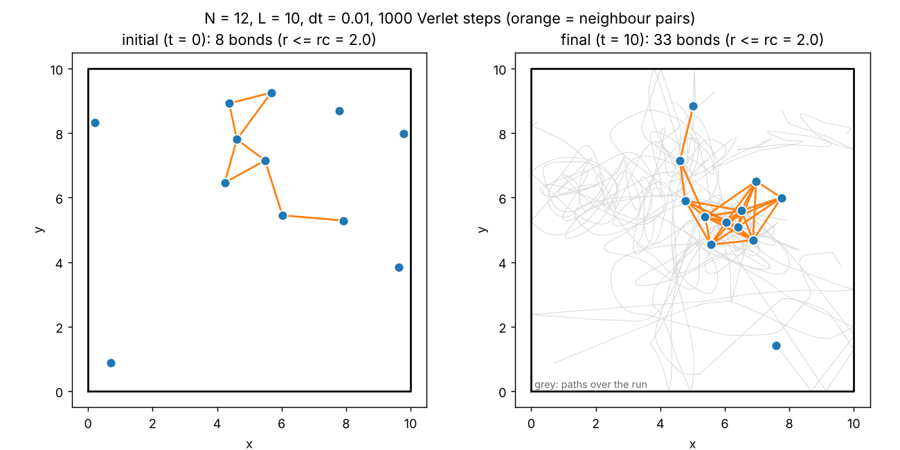

# Baseline simulator and verification (Task 1)
Member 1 (Roshan Raju, MS26BTECH11013): model setup and verification

## What I did

I wrote `toymodel.py`, the small simulator that the rest of the group imports, and `verify.py`,
which runs every Task 1 check and writes the numbers to `results/`. The code follows the
handout: `walls_reflect`, `pairwise_distances` with broadcasting, a Python double-loop force
and the vectorized force, the handout `step_once` (called `step_euler` here) and `step_smooth`
(called `step_verlet`), the two energy functions and a `run` driver. All 47 checks in
`results/checks.csv` pass. Running the default system also showed a property of the model
itself (the potential jumps at the cutoff) that matters for the energy study, so I describe it
at the end.

## Model description and assumptions

- N = 12 point particles of mass m = 1 in a 2D square box of side L = 10. No gravity, no
  temperature bath, no periodic images.
- Initial state (`init_system`): `np.random.seed(0)`, positions uniform in [0, L]^2, velocity
  components uniform in [-1, 1].
- Particles interact only in pairs, through a linear spring with stiffness k = 15 and rest
  length r0 = 0.8. A pair interacts only when its distance is inside the cutoff, 0 < r <= rc
  with rc = 2.0. Beyond rc the force and the energy are taken as exactly zero.
- Walls are hard and elastic: a particle that has crossed a wall is put back on the wall and
  the velocity component normal to that wall changes sign.
- Time step dt = 0.01, 1000 steps (t = 0 to 10).

## Governing equations

For particle i with position r_i and velocity v_i, write the displacement and distance to
particle j as

```
d_ij = r_i - r_j,      r_ij = |d_ij| = sqrt((x_i - x_j)^2 + (y_i - y_j)^2)
```

Pair force on i from j (attractive when r > r0, repulsive when r < r0):

```
F_ij = -k (r_ij - r0) d_ij / r_ij     if 0 < r_ij <= rc,   else 0
F_ji = -F_ij                          (Newton's third law)
F_i  = sum over j of F_ij,            m_i dv_i/dt = F_i,   dr_i/dt = v_i
```

Energies:

```
U_ij = 0.5 k (r_ij - r0)^2   for 0 < r_ij <= rc,   U = sum over pairs i < j of U_ij
K    = sum over i of 0.5 m_i |v_i|^2,              E_total = K + U
```

Semi-implicit Euler (handout `step_once`, our `step_euler`):

```
v(n+1) = v(n) + F(r(n)) / m * dt
r(n+1) = r(n) + v(n+1) * dt
then wall reflection on r(n+1), v(n+1)
```

Velocity Verlet (handout `step_smooth`, our `step_verlet`):

```
v_half  = v(n) + 0.5 * F(r(n)) / m * dt
r(n+1)  = r(n) + v_half * dt
wall reflection on r(n+1), v_half
v(n+1)  = v_half + 0.5 * F(r(n+1)) / m * dt
```

The force from the end of one Verlet step is passed into the next step, so each step needs only
one force evaluation.

Wall rule (applied per coordinate, x shown, y is the same):

```
if x < 0:  vx = -vx,  x = 0
if x > L:  vx = -vx,  x = L
```

In code the distances are built in one shot with `pos[:, None, :] - pos[None, :, :]`, which
gives the (N, N, 2) array `d`. `dist` is its length along the last axis and
`neighbors = (dist > 0) & (dist <= rc)`, so the diagonal can never be a neighbour. Both force
functions call `pairwise_distances` and do not recompute distances. The vectorized force uses the
handout line `u = d / (dist[:, :, None] + 1e-12)` so the diagonal gives 0/1e-12 = 0 instead of 0/0.

## Results

All numbers below are copied from `results/verification_summary.txt` and the csv files next to it.

### Memory layout (handout section 1)

| array | dtype | itemsize (bytes) | nbytes for (12, 2) | C sizeof on this machine |
|---|---|---|---|---|
| pos | float64 | 8 | 192 | sizeof(double) = 8 |
| pos32 | float32 | 4 | 96 | sizeof(float) = 4 |

The C sizes were read with `ctypes.sizeof`, so they are the real values of the local C compiler.
float32 uses exactly half the memory (ratio 2.0). A big simulation might prefer float32 because
it halves memory and memory traffic, at the price of about 7 significant digits instead of 16
(Member 3 measures what this costs in accuracy).

### Distance matrix and neighbour mask

| check (N = 12 initial positions) | value |
|---|---|
| max \|dist - dist.T\| | 0.0 |
| max \|d + d.transpose(1,0,2)\| (d antisymmetric) | 0.0 |
| max \|diag(dist)\| | 0.0 |
| True entries on diag(neighbors) | 0 |
| max \|dist - slow double-loop dist\| | 0.0 |
| same three checks on all 1001 frames of the run | 0.0, 0.0, 0 self-neighbour entries |

Symmetry comes out exactly zero, not just small. This makes sense: in floating point
a - b = -(b - a) exactly, and squaring removes the sign, so dist[i, j] and dist[j, i] are the
same number bit for bit. At t = 0 the neighbour counts are [3, 2, 2, 2, 0, 1, 2, 0, 0, 0, 0, 4],
which is 8 pairs.

**Hand-made 4-particle example.** I picked A = (1, 1), B = (3, 1), C = (1, 3.5), D = (4, 3).
By hand: AB = 2 (exactly rc), AC = 2.5, BD = sqrt(5) = 2.236, CD = sqrt(9.25) = 3.041,
BC = 3.202, AD = 3.606. AB was put exactly on the cutoff to test the `<=`, and CD just
outside 3 to test rc = 3.

| rc | neighbour counts by hand | from code |
|---|---|---|
| 2.0 | [1, 1, 0, 0] (only AB) | [1, 1, 0, 0] |
| 3.0 | [2, 2, 1, 1] (AB, AC, BD) | [2, 2, 1, 1] |

For rc = 2 the only force is the AB spring stretched by 1.2, so by hand F_A = (+18, 0) and
F_B = (-18, 0). The loop version gives this exactly; the vectorized one is off by 9.0e-12. That
error is the `+ 1e-12` term: it shrinks the unit vector by 1e-12 / 2, and 18 x 5e-13 = 9e-12.
The potential energy came out as 10.799999999999999 (hand value 0.5 x 15 x 1.2^2 = 10.8).

**200 particles in a 50 x 50 box** (`results/neighbours_200.csv`, separate random array with seed 1):

| rc | average neighbours | estimate (199/2500) pi rc^2 | ratio | self-neighbours |
|---|---|---|---|---|
| 2 | 0.760 | 1.000 | 0.76 | 0 |
| 3 | 1.970 | 2.251 | 0.88 | 0 |
| 5 | 5.500 | 6.252 | 0.88 | 0 |

The counts grow roughly like rc^2 as expected. They are below the uniform-density estimate
because particles near the walls have part of their cutoff circle outside the box; for rc = 2
the sample is also small (only 76 pairs in total), so the ratio is noisier.

### Forces

| check | value |
|---|---|
| max \|F_vec - F_loop\|, N = 12 at t = 0 | 1.08e-11 (largest force component 16.8) |
| max \|F_vec - F_loop\|, 200 particles, rc = 2 / 3 / 5 | 2.36e-11 / 3.31e-11 / 6.32e-11 |
| max over 1001 steps of \|\|sum_i F_i\|\|, vectorized, float64 | 3.26e-14 |
| same, loop force, float64 | 2.84e-14 |
| same, Euler run, float64 | 2.51e-14 |
| same, vectorized, float32 run | 1.97e-05 |
| largest single force component in the run | 72.58 |
| max \|pos(vec) - pos(loop)\| over the whole run | 1.32e-09 |

The two force versions agree to about 1e-11, again set by the 1e-12 term. The total internal
force stays at the 1e-14 level, which is 72.58 x (machine epsilon 2.2e-16) times a small
factor, so it is rounding error and not a missing term. In float32 the same check gives about
2e-5, which is the same story with epsilon 1.2e-7. Running the full 1000 steps with the loop
force instead of the vectorized force moves the particles by at most 1.3e-9.

### Walls

| case | start pos, vel | end pos, vel |
|---|---|---|
| handout test | [10.1, 5], [1, 0.3] | [10.0, 5], [-1.0, 0.3] |
| left | [-0.1, 5], [-0.7, 0.2] | [0, 5], [0.7, 0.2] |
| right | [10.1, 5], [0.7, 0.2] | [10, 5], [-0.7, 0.2] |
| bottom | [5, -0.1], [0.2, -0.7] | [5, 0], [0.2, 0.7] |
| top | [5, 10.1], [0.2, 0.7] | [5, 10], [0.2, -0.7] |
| corner | [-0.2, 10.3], [-0.5, 0.9] | [0, 10], [0.5, -0.9] |
| inside (no change) | [3, 4], [0.5, -0.5] | [3, 4], [0.5, -0.5] |

All end states match the hand values exactly (`results/wall_tests.csv`). Only the normal
velocity component flips, and the corner case flips both.

Over full 1000-step runs (`results/box_check.csv`), the minimum and maximum of x and y over all
frames are exactly 0 and 10 and no coordinate is ever outside the box:

| run | x range | y range | coords outside | wall hits (left, right, bottom, top) |
|---|---|---|---|---|
| Verlet, vectorized, float64 | [0, 10] | [0, 10] | 0 | 4, 5, 4, 3 (16) |
| Verlet, loop force, float64 | [0, 10] | [0, 10] | 0 | 4, 5, 4, 3 (16) |
| Euler, float64 | [0, 10] | [0, 10] | 0 | 4, 7, 3, 4 (18) |
| Verlet, float32 | [0, 10] | [0, 10] | 0 | 4, 5, 4, 3 (16) |

I counted a wall hit as a particle sitting exactly on 0 or L after a step, because clamped
particles land there exactly.



The figure shows the start and end of the default Verlet run. At t = 0 there are 8 bonds; at
t = 10 most particles have pulled together into one cluster with 33 bonds.

### API checks

`run` copies its inputs (input arrays are unchanged after a run). With float32 input every
function returns float32: distances, both force versions, both energies, both steppers and all
arrays from `run`. I made `dt`, `k` and `r0` plain Python floats inside the functions because a
NumPy float64 scalar (for example from looping over `np.array([0.05, 0.02])`) would otherwise
turn float32 arrays into float64 under NumPy 2.

## Observation: the energy jumps at the cutoff

When I first ran the default system I expected E_total to stay close to its start value, but it
went from E(0) = 36.57 to E(10) = 303.90 (max relative change 7.91). I first suspected the
integrator, but the force checks above were fine, so I looked at the pair count. The reason is
in the model: U_ij is not zero at r = rc, it is 0.5 x 15 x (2.0 - 0.8)^2 = **10.8**. The force
also does not go to zero there (it drops from 18 to 0). So whenever a pair moves inside rc,
U jumps up by 10.8 with no change in K, and the reverse when a pair leaves. In the run the pair
count went from 8 to 33 and changed on 219 of the 1000 steps; the largest one-step change in E
was 32.47 (three pairs entering at once). Seen another way, each pair inside the cutoff sits in a
well that is 10.8 deep compared with outside, and the force pulls it in without the matching
barrier, so the system clusters and K grows from 3.34 to 201.92.

If I subtract 10.8 for every pair inside the cutoff (equivalent to using the shifted potential
U_ij - U(rc), which is continuous), the energy goes from -49.83 to -52.50, with a maximum
deviation of 9.26 (18.6 %). That is much better but still not small; the leftover comes from the
force jump at rc and from close encounters. The particles can nearly pass through each other:
the closest pair over the run was at r = 0.0097 (t = 0.34), because the spring only gives a
barrier of 0.5 k r0^2 = 4.8 at r = 0. The biggest energy step without a pair change (1.05) was at
t = 7.75 when the closest pair was at r = 0.114. These numbers are in
`results/energy_cutoff_N12.csv`. Member 3 (`../member3_energy_precision`) does the proper timestep
study; anyone comparing E_total should keep the cutoff jump in mind.

## What I learned

- Checks that should be exactly zero (symmetry, the diagonal, self-neighbours, box limits) did
  come out exactly zero, while checks involving sums of forces come out at rounding level. It
  helps to know which kind of zero to expect before calling a test passed.
- The `+ 1e-12` in the handout is harmless for the physics but it sets the agreement between the
  loop and vectorized forces at about 1e-11; without knowing this I would have wondered why they
  were not equal.
- A small hand example with a pair exactly at rc caught the difference between `<` and `<=`
  before it could matter in a big run.
- "Energy is not conserved" here is not only an integrator question; part of it is the model
  definition. Counting the pairs explained most of the change.

## Links to other members

- Member 2 (`../member2_forces_efficiency_memory`) times `pair_forces_loop` and `pair_forces`
  from this file against a C version.
- Member 3 (`../member3_energy_precision`) uses `run`, `step_euler` and `step_verlet` for the
  energy/timestep and float32 studies.
- Member 4 (`../member4_animation_dissipation`) animates frames from `run` and adds drag.
- Member 5 (`../member5_innovation_recommendation`) uses `pair_forces` as the reference for the
  cell-list and Numba versions.
