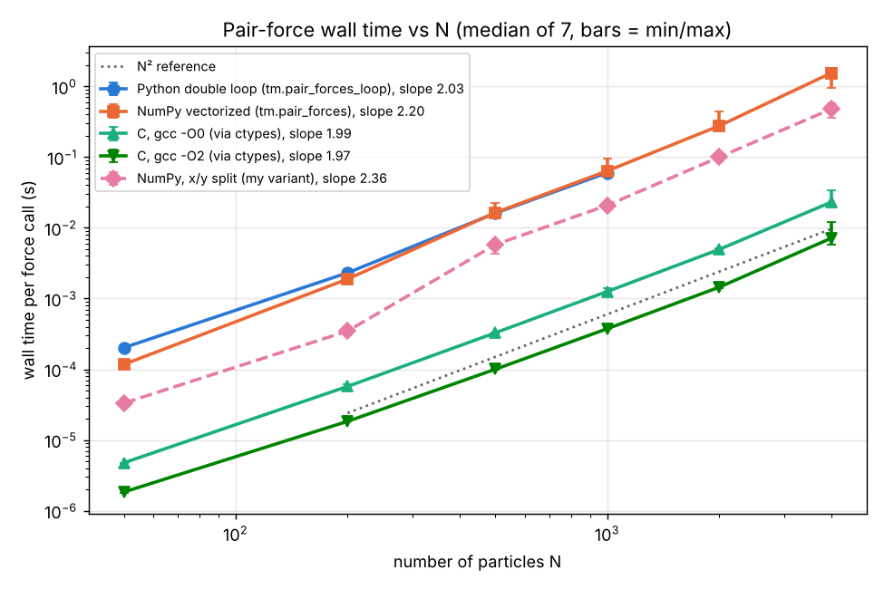
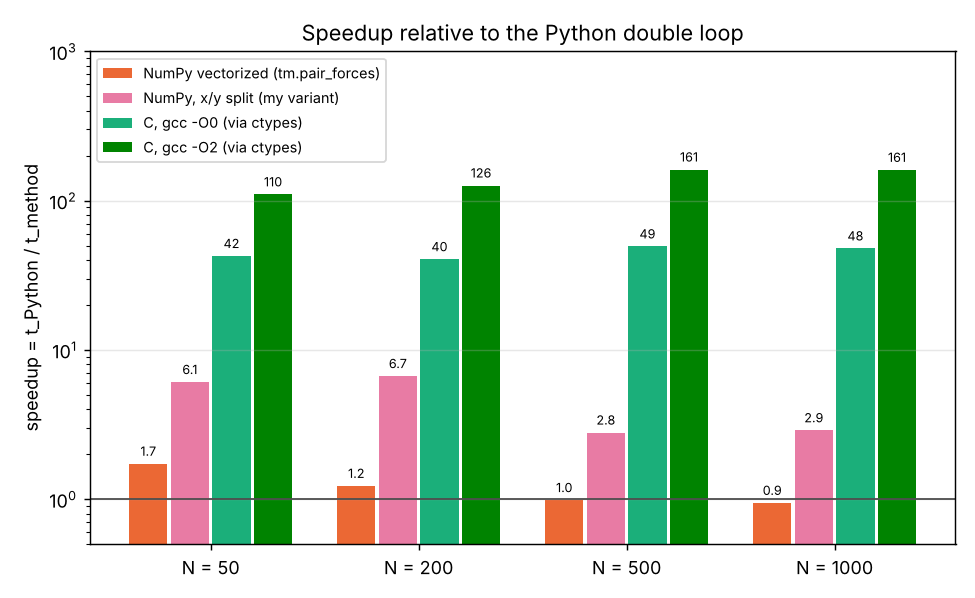
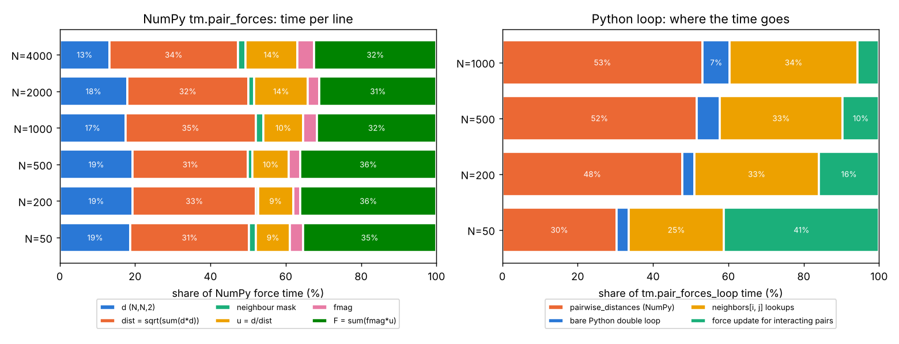
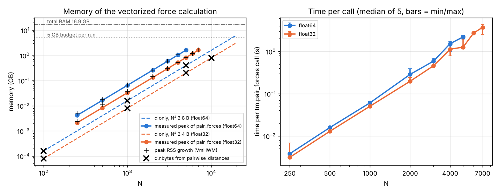

# Pair forces: computational efficiency, memory and scalability
Member 2 (Chandar, MS26BTECH11012): pair forces, timing and speedup (Task 6), memory and scalability (Task 7)

## 1. What I did

I compared three versions of the same spring pair force: the Python double loop `tm.pair_forces_loop`, the vectorized NumPy version `tm.pair_forces` (both from Member 1's `toymodel.py`), and a C version `pairforce.c` that I wrote. The C code is the same double loop as the handout (j > i, only pairs with 0 < r <= rc, `F[i] += f`, `F[j] -= f`). It is used in two ways:

1. **Standalone program.** `main` takes N on the command line, makes random positions with `srand(0)` and prints the timing. It is built with `gcc -O0` and `gcc -O2 ... -lm`, as the handout asks.
2. **Shared library.** The same function is compiled with `-DNO_MAIN -shared -fPIC` and called from Python through `ctypes`. That way it gets exactly the same positions as the Python versions.

For Task 7 I compared the theoretical size of the (N, N, 2) displacement array with what NumPy reports. I then measured the real peak memory and time of one full `tm.pair_forces` call up to N = 5000 (float64) and N = 7000 (float32).

## 2. Method

**Test systems.** The handout density is kept fixed: 12 particles in a 10 x 10 box gives n = 0.12, so L = sqrt(N/0.12). Positions come from `np.random.seed(0)`, `np.random.rand(N, 2) * L`, and every method gets the same array. The parameters are k = 15, r0 = 0.8 and rc = 2. At this density each particle has only 1.40 to 1.54 neighbours on average (`results/force_check.csv`). For example, at N = 1000 only 762 of the 499,500 pairs are inside rc.

**Timing.**
- Timer: `time.perf_counter`, with one warm-up call before each measurement.
- Repeats: 7 for every (method, N). The repeats are interleaved (A, B, C, A, B, C, ...) so that a burst of load from the other members hits all methods equally.
- Short calls: when one call is very short, each repeat runs it `number` times and divides (like `timeit`), so that one repeat lasts at least 0.05 s.
- Reported values: the median, plus min and max to show the spread.
- C timing: only the kernel call is timed. The pointers to the position and force arrays are prepared before timing. I also timed a full wrapper (`np.ascontiguousarray`, allocating F, then calling) to see what the conversion costs.
- Machine: Intel Xeon 2.30 GHz with 4 cores, Python 3.13.18, NumPy 2.5.3, gcc 13.3.0. The machine was shared: the other four members were running their own jobs at the same time, and the load average was 1.7 to 2.7 during my runs (`results/machine_info.txt`, `results/task6_log_run1.txt`). This is why I use medians.
- Reproducibility: I ran the whole benchmark twice (`timings_run1.csv` and `timings.csv`). For N >= 200 the medians of the two runs agree within 0 to 18% (the worst case was C at N = 4000); most are within 3%. The tables below come from the second run.

Speedup is t_Python / t_method. The log-log slope is a straight-line fit of log t against log N using N >= 200, since the smallest N is dominated by call overhead.

**Memory.** The theoretical size is M = N^2 * 2 * itemsize. The real peak of one `tm.pair_forces` call was measured with `tracemalloc` (NumPy reports its allocations to it). Each N runs in a fresh process (`peak_one_call.py`), and I cross-checked the result with the growth of the process peak RSS (VmHWM in `/proc/self/status`). All runs were kept below 2 GB.

## 3. Results: Task 6

### Same forces?

| N | max abs F | NumPy vs loop | C -O0 vs loop | C -O2 vs loop | C -O2 vs NumPy | abs(sum F), C |
|---|---|---|---|---|---|---|
| 50 | 38.6 | 4.7e-11 | 0.0 | 0.0 | 4.7e-11 | 2.2e-14 |
| 200 | 36.9 | 1.6e-10 | 0.0 | 0.0 | 1.6e-10 | 7.9e-15 |
| 500 | 41.8 | 9.5e-11 | 0.0 | 0.0 | 9.5e-11 | 1.3e-13 |
| 1000 | 43.8 | 8.1e-11 | 0.0 | 0.0 | 8.1e-11 | 4.4e-13 |
| 2000 | 39.6 | - | - | - | 4.4e-10 | 3.3e-13 |
| 4000 | 61.3 | - | - | - | 3.1e-10 | 8.0e-13 |

The C version gives bit-for-bit the same forces as the Python loop: it does the same floating point operations in the same order. NumPy differs at the 1e-10 level because of the `+ 1e-12` added to `dist` in the unit vector. That is a relative error of about 1e-12, which does not matter. All three implementations compute the same thing.

### Wall time (ms per force call; median, with min-max in brackets)

| method | N = 50 | 200 | 500 | 1000 | 2000 | 4000 |
|---|---|---|---|---|---|---|
| Python loop | 0.202 (0.200-0.203) | 2.31 (2.30-2.40) | 16.2 (16.0-17.1) | 60.1 (60.0-61.4) | - | - |
| NumPy (tm.pair_forces) | 0.117 (0.115-0.119) | 1.89 (1.88-2.50) | 16.4 (14.6-22.6) | 63.8 (62.6-95.6) | 277 (273-439) | 1540 (963-1840) |
| C -O0 (ctypes) | 0.00475 (0.00470-0.00478) | 0.0572 (0.0567-0.0610) | 0.328 (0.325-0.333) | 1.26 (1.25-1.41) | 4.95 (4.87-5.17) | 23.0 (19.9-33.9) |
| C -O2 (ctypes) | 0.00184 (0.00181-0.00195) | 0.0183 (0.0182-0.0208) | 0.100 (0.0995-0.104) | 0.375 (0.373-0.385) | 1.45 (1.42-1.46) | 7.11 (5.76-12.0) |
| NumPy x/y split (my variant) | 0.0332 | 0.347 | 5.80 | 20.8 | 99.9 | 477 |

Raw data: `results/timings.csv`. NumPy at N = 4000 has a very wide spread (963 to 1840 ms). It allocates hundreds of MB per call, so it suffers most when other people use the memory bus at the same time.

### Speedup relative to the Python loop

| N | NumPy | NumPy x/y | C -O0 | C -O2 |
|---|---|---|---|---|
| 50 | 1.72 | 6.08 | 42.5 | 110 |
| 200 | 1.22 | 6.67 | 40.5 | 126 |
| 500 | 0.98 | 2.79 | 49.3 | 161 |
| 1000 | 0.94 | 2.89 | 47.8 | 161 |

**Scaling.** The fitted log-log slopes (`results/loglog_slopes.csv`) are 2.03 for the Python loop, 1.99 for C -O0, 1.97 for C -O2 and 2.20 for NumPy. All methods are O(N^2), as expected for an all-pairs loop. Doubling N costs about 4x the time. The time per pair (`results/cost_per_pair.csv`) shows why NumPy is above 2:
- C -O2 stays at 0.72 to 0.92 ns per pair for N >= 200 (1.50 ns at N = 50).
- NumPy rises from 95 ns per pair (N = 50 to 200) to 193 ns (N = 4000).

At N = 200 the (N, N, 2) array is 640 KB and fits in cache. At N = 4000 it is 256 MB and every temporary has to go through main memory.

**-O2 vs -O0.** -O2 is 2.6x (N = 50) to 3.4x (N = 1000) faster. At -O0 every variable is loaded from and stored to memory at each use; -O2 keeps them in registers.

**ctypes overhead** (`results/ctypes_overhead.csv`). The full wrapper (contiguous float64 conversion, allocation of F, ctypes argument conversion) adds 1.8 to 2.5 µs per call. At N = 50 that doubles the cost (1.84 to 3.67 µs); from N = 500 on it is below 2%. At N = 4000 the difference came out negative (-0.34 ms), which is just noise from the shared machine. The standalone C program (`results/c_standalone.csv`) gives 0.380 ms at N = 1000 against 0.375 ms through ctypes, so the call itself costs nothing measurable at that size. At N = 50 the standalone kernel takes 1.17 µs against 1.84 µs via ctypes, so the bare ctypes call costs about 0.7 µs. The standalone program uses C `rand()` positions, so its positions are not the same as the Python ones, but the density is the same.

### Where the time goes (the bottleneck)

**Python loop at N = 1000** (`results/breakdown_python_loop.csv`). Total time is 59.6 ms. It splits like this:

| part | time | share |
|---|---|---|
| `pairwise_distances` (vectorized NumPy) | 31.7 ms | 53% |
| empty `for i / for j` loop | 4.3 ms | 7% (8.6 ns per pair) |
| `if neighbors[i, j]` lookups | 20.2 ms | 34% (40 ns per lookup) |
| force update for the 762 interacting pairs | 3.4 ms | 6% (about 4.5 µs per pair) |

Excluding `pairwise_distances`, the loop costs 56 ns per pair iteration. So the "Python loop" is really half NumPy. Its Python part is cheap because the expensive body almost never runs at this low density. My first version of this breakdown timed the four parts one after another and the shares added up to 117% at N = 500, because the load changed between measurements. I then timed them interleaved, and now they add up.

**NumPy at N = 1000** (`results/breakdown_numpy.csv`). Each line of `tm.pair_forces` timed separately:

| line | time |
|---|---|
| `d` | 9.2 ms |
| `dist = sqrt(sum(d*d, axis=2))` | 18.3 ms |
| neighbour mask | 1.1 ms |
| `u` | 5.5 ms |
| `fmag` | 2.0 ms |
| `F = sum(fmag*u, axis=1)` | 16.8 ms |

The two reductions (`dist` and `F`) take two thirds of the time. The lines that touch the (N, N, 2) arrays are the slow ones. The last axis has length 2, so NumPy's inner loop runs over only 2 numbers at a time and pays its per-loop overhead about N^2 times.

To check this I wrote `pair_forces_xy`. It does the same maths and allocates the same number of bytes, but keeps x and y in two (N, N) arrays. Its forces agree with `tm.pair_forces` to 1.4e-14, yet:
- building dx, dy takes 2.8 ms instead of 9.2 ms for `d`;
- `dist` takes 3.7 ms instead of 18.3 ms;
- the whole force call is 2.8 to 5.4x faster than `tm.pair_forces`.

Since the memory traffic is the same in both versions, the difference comes from the array layout, not from the amount of data.

**Why C beats both.** C -O2 needs 0.75 ns per pair at N = 1000, against 128 ns per pair for NumPy (counting N(N-1)/2 pairs for both). Three things add up here:
1. NumPy computes all N^2 entries, so it does twice the work of the j > i loop.
2. It creates about eight N^2-sized temporaries (d, d*d, dist, u, fmag, fmag*u, ...), each written to memory and read back. C keeps dx, dy and r2 in registers and only touches the 2N numbers of `pos` and `F`.
3. C rejects a far pair after one multiply-add and a compare, and only does the sqrt and division for the 0.15% of pairs that interact. NumPy does sqrt and division for all N^2 entries.

**Answer to the handout question (ordering).** At N = 1000 the order is C -O2 (0.375 ms) < C -O0 (1.26 ms) << NumPy (63.8 ms) ≈ Python loop (60.1 ms). Compiled C is 48 to 161x faster than Python because each pair is a few machine instructions (0.75 ns) instead of interpreted bytecode plus a NumPy scalar lookup (56 ns), and -O2 gains another 3.4x over -O0 by keeping values in registers. NumPy did not beat the loop here: the handout's loop already uses vectorized `pairwise_distances` for 53% of its time and only runs the Python force code for 762 pairs, while NumPy pays for full N x N temporaries with a length-2 last axis. Vectorization overhead (allocation, memory traffic, small inner loops) is real and grows with N.

## 4. Results: Task 7

### Theoretical size of d vs NumPy nbytes

| N | float32 theory | float64 theory | measured d.nbytes (f32 / f64) | peak inside pairwise_distances (f32 / f64) |
|---|---|---|---|---|
| 100 | 80 KB | 160 KB | 80,000 / 160,000 B | 0.20 / 0.40 MB |
| 1000 | 8 MB | 16 MB | 8,000,000 / 16,000,000 B | 20.0 / 40.0 MB |
| 5000 | 200 MB | 400 MB | 200,000,000 / 400,000,000 B | 500 / 1000 MB |
| 10000 | 800 MB | 1.6 GB | 800,000,000 / not built | 2000 MB / not built |

Source: `results/memory_theory_vs_nbytes.csv`. `nbytes` matches N^2 * 2 * itemsize exactly in all seven cases I could build. I did not build N = 10000 in float64: `pairwise_distances` alone peaks at 2.5x d (d and the temporary d*d plus dist), which would be about 4 GB.

### Real peak of one `tm.pair_forces` call

| N | dtype | d alone | tracemalloc peak | peak RSS growth | peak / d | time per call (median) |
|---|---|---|---|---|---|---|
| 1000 | float64 | 16 MB | 65.1 MB | 65.9 MB | 4.07 | 60.7 ms |
| 2000 | float64 | 64 MB | 260.1 MB | 260.9 MB | 4.06 | 0.285 s |
| 3000 | float64 | 144 MB | 585.1 MB | 586.0 MB | 4.06 | 0.590 s |
| 4000 | float64 | 256 MB | 1040.1 MB | 1041.0 MB | 4.06 | 1.53 s |
| 5000 | float64 | 400 MB | 1625.1 MB | 1625.9 MB | 4.06 | 2.20 s |
| 2000 | float32 | 32 MB | 132.0 MB | 148.7 MB | 4.13 | 0.197 s |
| 5000 | float32 | 200 MB | 825.0 MB | 826.0 MB | 4.13 | 1.26 s |
| 7000 | float32 | 392 MB | 1617.1 MB | 1617.8 MB | 4.13 | 3.69 s |

Full table: `results/memory_peak_pair_forces.csv`.

The peak is not d. It is about four times d. The ratio is exactly 4 + 1/16 for float64 and 4 + 1/8 for float32, which means peak = (8 * itemsize + 1) * N^2 bytes. At the moment of the peak these arrays are all alive:

| array | size in units of N^2 numbers |
|---|---|
| d | 2 |
| dist | 1 |
| u | 2 |
| fmag | 1 |
| fmag[:, :, None] * u | 2 |
| bool neighbour mask | N^2 bytes |

My fit gives 65.01 N^2 bytes for float64 and 33.00 N^2 for float32. The RSS check agrees with tracemalloc to within 0.1% for N >= 3000. At first I used `ru_maxrss` from `getrusage` and got zero growth for every N. It turned out that the child process inherits the parent's maximum, and the parent had already used 2 GB in part A. I switched to VmHWM, which starts fresh in each process.

float32 halves the memory, but the time per call is only 1.2x (N = 1000) to 1.7x (N = 5000) shorter. These numbers are noisy because of the shared machine: Member 3 measured 1.51x at N = 1000 at a different time. Member 3 looks at float32 vs float64 accuracy in detail.

### At what N does the vectorized approach become impractical?

The machine has 16.9 GB of RAM (15.7 GiB); 15.8 to 16.0 GB was available during my runs. We agreed on 5 GB per run because the machine is shared. Extrapolating peak = 65.01 N^2 bytes (float64) from `results/memory_limits.txt`:

- **Memory limit.** One force call reaches the 5 GB budget at N ≈ 8770 and all of the RAM at N ≈ 16,100. For float32 these are N ≈ 12,300 and N ≈ 22,600. At N = 10,000 in float64 one call needs 6.5 GB, although d itself is "only" 1.6 GB.
- **Time limit.** The time per call grows as about 8.0e-8 * N^2 s. `tm.run` also calls `potential_energy` at every saved step (another `pairwise_distances`, about 3.5e-8 * N^2 s). I checked this estimate with a real 30-step `tm.run` at N = 2000: it took 0.464 s per step, against 0.425 s predicted. A 1000-step run (the handout T) then takes:

  | N | time for 1000 steps |
  |---|---|
  | 2000 | 7.7 min |
  | 5000 | 48 min |
  | 10,000 | 3.2 h |

So on this machine time becomes the problem before memory. My answer: the fully vectorized force is fine up to N ≈ 2000. It becomes impractical at about **N ≈ 5000**, where one 1000-step run takes almost an hour, and a timestep study with four dt values (as in Task 3) would take most of a working day. Above N ≈ 9000 it breaks our 5 GB budget, and above N ≈ 16,000 (float64) it cannot run on this computer at all.

The C loop does not have the memory problem, since it only stores pos and F (32N bytes, 128 KB at N = 4000). Its time is still O(N^2): at about 0.9 ns per pair, N = 10,000 would be about 45 ms per call, but that is an extrapolation I did not measure. To go to large N, both the memory and the N^2 have to go. Member 5's cell-list version only checks particles in neighbouring cells, so its cost grows like N at fixed density. A method that is fastest at N = 50 (NumPy beats the loop 1.7x there) is not the one that scales.

## 5. What I learned

- The handout calls the NumPy version the "faster version". For this model at this density it is not faster than the Python loop for N >= 500. The loop is already half vectorized, and almost all pairs are rejected cheaply. I did not expect this. I checked it twice (run 1: 0.96x at N = 1000, run 2: 0.94x), and the per-line timings explain it.
- How the data is laid out matters as much as whether it is vectorized: the same NumPy maths in (N, N) arrays instead of (N, N, 2) was 2.8 to 5.4x faster.
- Memory estimates from the size of one array are too optimistic. The real peak was 4x the size of d because of the temporaries.
- On a shared machine single timings are unreliable (NumPy at N = 4000 ranged from 0.96 to 1.84 s). Medians, interleaved repeats and a second full run were necessary before trusting any ratio.

Links to other members' work: `toymodel.py` and the verification are Member 1's (`../member1_baseline_verification/`). float32 vs float64 accuracy is Member 3's (`../member3_energy_precision/report.md`). The cell-list and Numba versions for large N, and the final choice of force method, are Member 5's (`../member5_innovation_recommendation/report.md`).
