# Energy, Timestep Accuracy and Numerical Precision
Member 3 (Gowtham, MS26BTECH11026): time integration and energy (Task 3), float32 vs float64 (Task 5)

## 1. What I did

I used the shared simulator `member1_baseline_verification/toymodel.py` (not modified) and wrote six scripts in my folder:

| script | what it does |
|---|---|
| `energy_timestep.py` | Task 3 main study: dt = 0.05 ... 0.0005, Euler and Verlet, K, U, E, shifted energy, 5 seeds |
| `integrator_control.py` | control runs with no cutoff crossings, to measure the integrator error alone; log-log fit |
| `error_sources.py` | splits the energy error of the default run into cutoff crossings, wall contacts, close passes and smooth steps |
| `precision_accuracy.py` | float32 vs float64 trajectories, eps_pos(t), sensitivity test, energy statistics |
| `precision_cost.py` | memory (nbytes, tracemalloc peak) and median timings in both precisions |
| `common.py` | helpers: pair counting, shifted energy, eps_E_max, relaxed cluster |

The parameters are the handout ones (N = 12, L = 10, k = 15, r0 = 0.8, rc = 2, m = 1, seed 0) unless stated. "Euler" is the handout `step_once`. It updates v first and then x with the new v, so it is semi-implicit (symplectic) Euler, not the explicit one. "Verlet" is the handout `step_smooth` (velocity Verlet). Every run in Task 3 lasts t = 10, so a smaller dt means more steps (200 steps at dt = 0.05, 20000 at dt = 0.0005).

## 2. Equations

- K = sum 0.5 m v^2, U = sum over pairs i<j with r_ij <= rc of 0.5 k (r_ij - r0)^2, E = K + U
- eps_E_max = max_t |E(t) - E(0)| / |E(0)| (assignment definition)
- Shifted energy: E_shift = K + sum over pairs with r <= rc of [0.5 k (r - r0)^2 - 0.5 k (rc - r0)^2] = E - 10.8 * npairs

The force is -dU/dr inside rc and zero outside. So the exact dynamics conserve E_shift, not E. The raw U is 10.8 per pair at r = rc and drops to 0 just outside, so E jumps every time a pair enters or leaves the cutoff. E_shift is continuous at rc. Only the force still jumps there, from magnitude 18 to 0.

## 3. Task 3 results

### 3.1 The raw E_total cannot be conserved by any dt

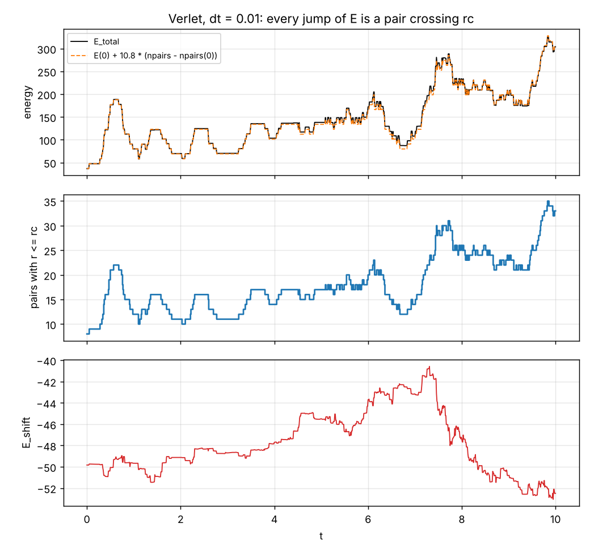

In the top panel, the orange dashed curve is E(0) + 10.8 * (change in pair count) and it sits on top of E(t). On the 219 steps (out of 1000) where the pair count changes, a least-squares fit of the energy change against the pair-count change gives a slope of **10.7959**, against the expected 10.8 (`results/cutoff_jumps_dt0.01_verlet.txt`). The mean |dE| per step is 11.79 on those steps and 0.027 on the other steps. The pair count grows from 8 to 33, and E grows from 36.57 to 303.90. E_shift (bottom panel) stays between about -53 and -41.

Table 1: eps_E_max for raw E and for E_shift, seed 0, t = 10 (`results/energy_dt_table.csv`). The run time is a single measurement of `tm.run` on a shared machine, so treat it as a rough guide only.

| dt | steps | Euler eps_E (raw) | Euler eps (E_shift) | Verlet eps_E (raw) | Verlet eps (E_shift) | Verlet run time (s) |
|---|---|---|---|---|---|---|
| 0.05 | 200 | 4.420 | 1.594 | 8.018 | 2.434 | 0.01 |
| 0.02 | 500 | 9.497 | 0.635 | 5.668 | 0.683 | 0.03 |
| 0.01 | 1000 | 5.932 | 0.143 | 7.914 | 0.186 | 0.06 |
| 0.005 | 2000 | 8.012 | 0.107 | 4.393 | 0.0533 | 0.12 |
| 0.002 | 5000 | 5.954 | 0.0414 | 4.152 | 0.0435 | 0.29 |
| 0.001 | 10000 | 10.635 | 0.0266 | 4.148 | 0.0130 | 0.67 |
| 0.0005 | 20000 | 6.208 | 0.0062 | 5.604 | 0.0071 | 1.39 |

The raw eps_E_max is 4 to 11 (400 % to 1000 %) for every dt and both methods. It does not get smaller with dt because it measures how many pairs ended up bonded, which is physics of this model and not an integration error. So the assignment's eps_E_max, computed on the raw E, cannot be used to choose dt for this model. I used E_shift instead.

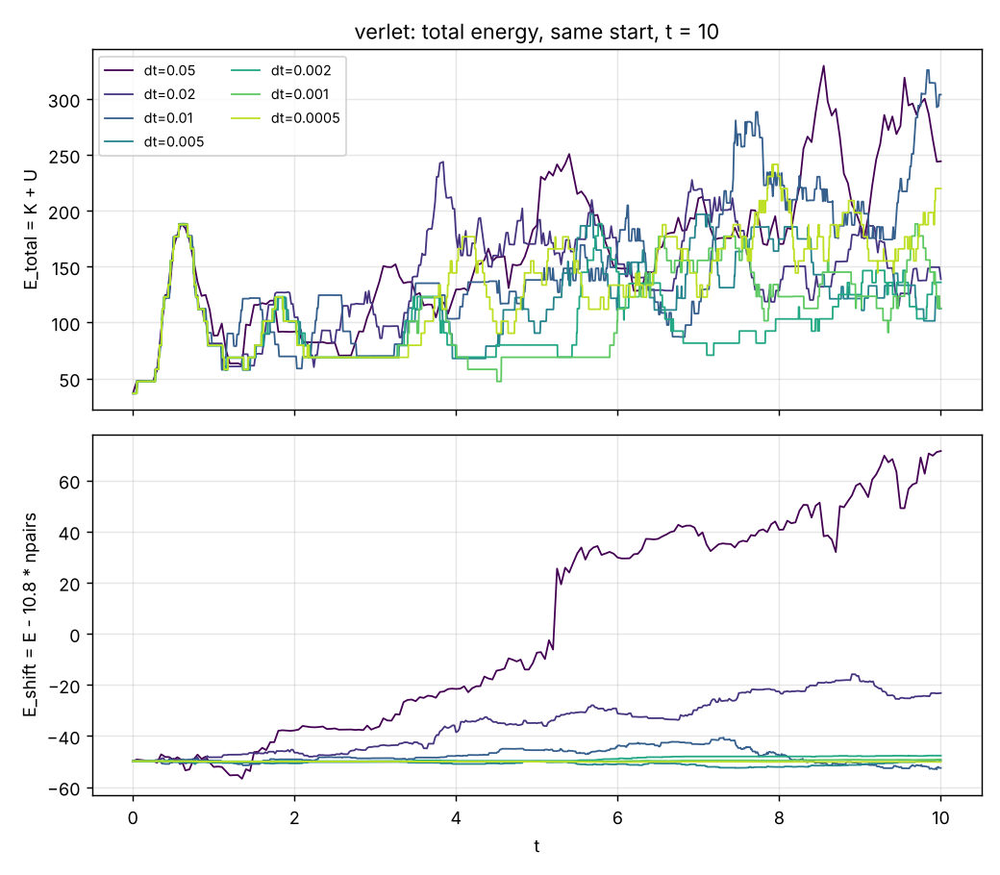
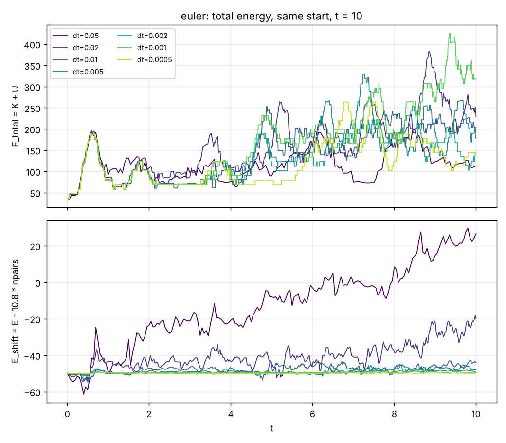
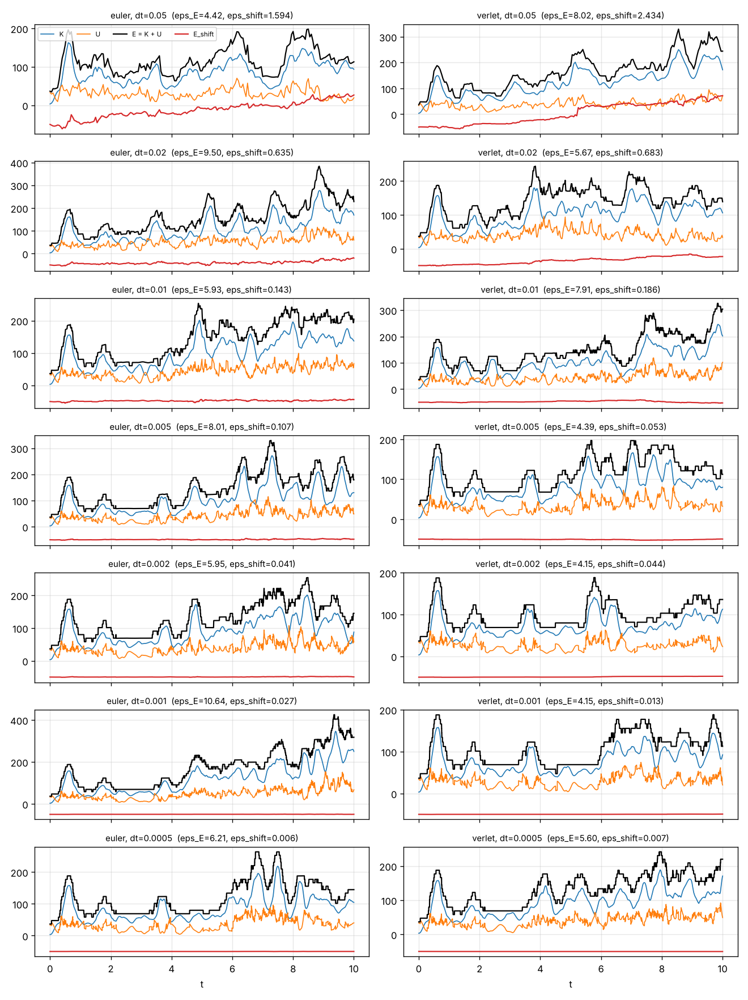

K and U exchange energy all the time (the orange and blue curves in the panels). The kinetic energy rises from 3.34 to between 80 and 250 by t = 10, depending on the run. This is not an error. With the shifted potential, each bonded pair sits in a well 10.8 deep, so when particles cluster they convert this well energy into kinetic energy. At dt = 0.05 both methods heat the system: E_shift goes from -49.83 to +26.66 (Euler) and +71.46 (Verlet). The runs for different dt also follow different paths after about t = 2. That is the sensitivity discussed in Task 5 below.

### 3.2 Separating the two error sources

**(1) The model (cutoff).** The E_shift errors in Table 1 fall roughly in proportion to dt for both methods. To check that this is not a feature of seed 0, I repeated the study for seeds 0 to 4 (`results/energy_dt_seeds_summary.csv`):

| dt | Euler median eps(E_shift) | Euler max | Verlet median eps(E_shift) | Verlet max |
|---|---|---|---|---|
| 0.01 | 0.143 | 0.258 | 0.186 | 0.324 |
| 0.005 | 0.106 | 0.179 | 0.0716 | 0.158 |
| 0.002 | 0.0415 | 0.0745 | 0.0266 | 0.0435 |
| 0.001 | 0.0179 | 0.0266 | 0.0114 | 0.0329 |
| 0.0005 | 0.00696 | 0.0126 | 0.00729 | 0.00956 |

**(2) The integrator alone.** My first try at a control run used rc = 1000 (every pair interacts) from the default start. It was far too violent: E(0) = 11615, pairs passing as close as r = 0.001, an irregular error curve, and with the walls in place the energy blew up (eps_E up to about 8000 at dt = 0.05). I replaced it with a gentler control. I took the seed-0 positions, squeezed them into a 2x2 region and let them slide downhill until the forces were below 2.5e-8. The result is a compact cluster with pair distances from 0.317 to 1.122. With the normal rc = 2, all 66 pairs interact for the whole run and none crosses rc. The seed-0 velocities are used.
- Control A: cluster in the middle of the box, no wall contact (checked: 0 wall frames, pair count 66 in every frame).
- Control B: the same cluster moved to x = 1.5 with an extra vx = -1, so it hits the left wall.

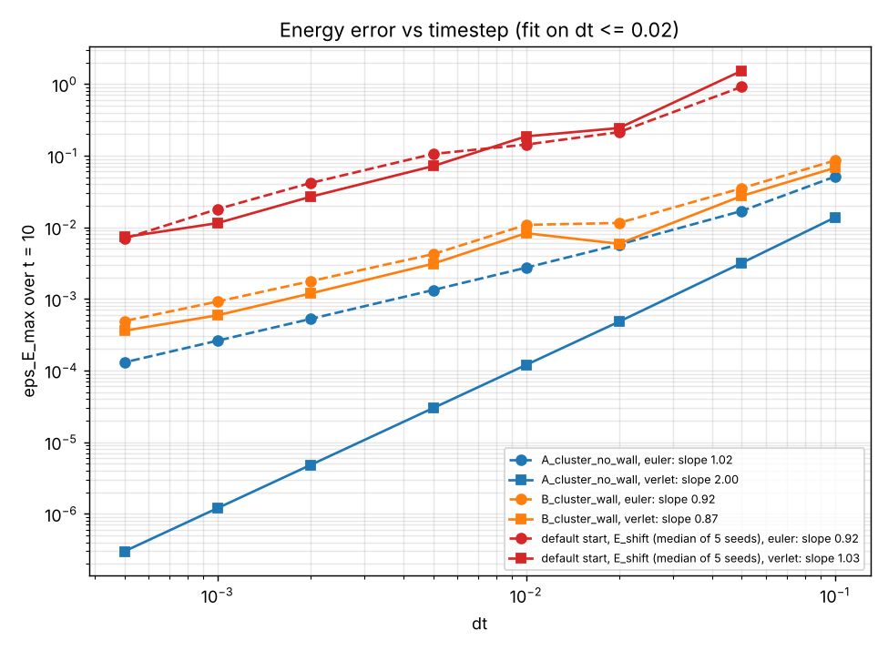

Fitted eps = C dt^p on dt <= 0.02 (`results/control_slopes.txt`, `results/control_eps_vs_dt.csv`):

| case | Euler slope p | Verlet slope p | Euler eps at dt = 0.01 | Verlet eps at dt = 0.01 |
|---|---|---|---|---|
| A: cluster, no wall | 1.024 | **2.001** | 2.73e-3 | 1.20e-4 |
| B: cluster hits wall | 0.917 | 0.874 | 1.08e-2 | 8.27e-3 |
| default start, E_shift (median of 5 seeds) | 0.925 | 1.026 | 0.143 | 0.186 |

In control A, Verlet behaves as expected for a second-order method: halving dt cuts the error by 4 (1.197e-4 at dt = 0.01, 2.990e-5 at dt = 0.005). Euler is first order and about 23 times worse at dt = 0.01. In the default model, Verlet loses its second order and is no better than Euler. This is because the force jumps by 18 when a pair crosses rc. The integrator only notices the crossing at the next step, so each crossing leaves an energy error proportional to dt. There are 100 to 300 crossings in t = 10.

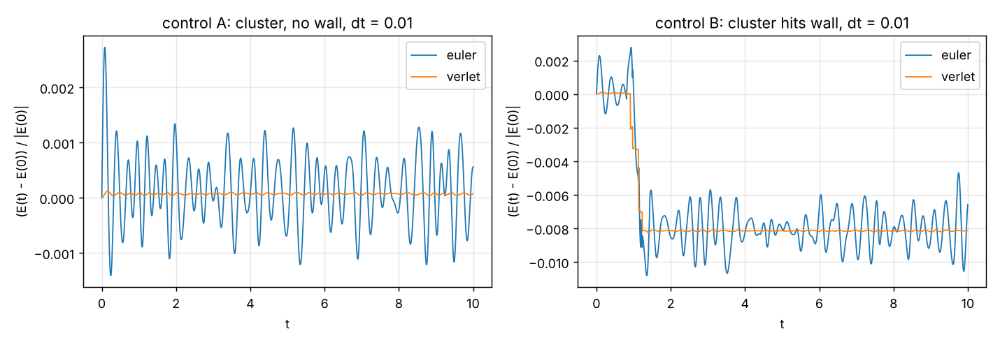

In control A the Verlet error is a small bounded wiggle, and the Euler error oscillates about 20 times larger without drifting. In control B, Verlet's energy steps down at each wall contact (around t = 1). The error becomes 69 times larger than in A at the same dt (8.27e-3 vs 1.20e-4).

**Wall clamp.** `walls_reflect` puts a particle that left the box exactly on the wall (x = 0 or L). An exact reflection would put it at its mirror position (-x). If the particle has neighbours, this moves U. `error_sources.py` measures U_shift(clamped) - U_shift(mirror) at every clamp in the default run. At dt = 0.01 (Verlet), 6 clamps changed U, adding +2.24 in total. At dt = 0.001, 10 clamps added +0.36. Clamps of particles with no neighbour change nothing, because flipping the velocity keeps K.

### 3.3 Where the error is made in the default run

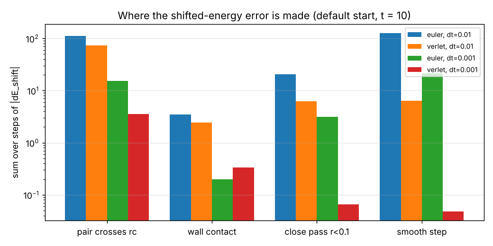

Each step is put in one class, checked in this order: the pair set changed, a wall contact, a close pass r < 0.1, or a smooth step. For Verlet (`results/error_sources.txt`):

| Verlet | steps | sum of abs(dE_shift) | net dE_shift |
|---|---|---|---|
| dt = 0.01, pair crosses rc | 238 | 72.68 | -3.74 |
| dt = 0.01, wall contact | 12 | 2.41 | +1.82 |
| dt = 0.01, close pass | 50 | 6.26 | -0.59 |
| dt = 0.01, smooth | 700 | 6.33 | -0.15 |
| dt = 0.001, pair crosses rc | 143 | 3.55 | +0.31 |
| dt = 0.001, wall contact | 19 | 0.34 | +0.34 |
| dt = 0.001, close pass | 529 | 0.066 | +0.005 |
| dt = 0.001, smooth | 9309 | 0.048 | -0.001 |

Crossing steps are about a quarter of the steps at dt = 0.01, but they carry 83 % of the summed error at dt = 0.01 and 89 % at dt = 0.001. Their errors have random signs and partly cancel. The wall errors in this run all push the energy up. At dt = 0.001 the walls give +0.34 of the total final drift of +0.65 (E_shift from -49.83 to -49.18), about half. For Euler the classes are harder to read. Its energy oscillates on every step (as in control A), so the "smooth" class adds up to 125.8 at dt = 0.01. Its large net values on crossing steps (-93.5) and smooth steps (+98.9) almost cancel.

### 3.4 Largest timestep I can defend

**Accuracy target:** E_shift may drift by less than 1 % of |E_shift(0)| over t = 10, for every one of the 5 seeds. For seed 0, 1 % is about 0.5 energy units, which is under 5 % of the 10.8 depth of a single pair well. With an error that small, the energy books stay right to much less than one bond. A 10 % error is about half a bond.

**Answer: Verlet with dt = 0.0005** (worst seed 0.956 %, median 0.729 %). At dt = 0.001 Verlet fails (median 1.14 %, worst 3.29 %). Euler fails at dt = 0.0005 (worst seed 1.26 %), so Euler would need an even smaller dt. A t = 10 run at dt = 0.0005 is 20000 steps and took 1.39 s at N = 12, which is still cheap. If the group accepts a looser 5 % target, Verlet dt = 0.002 passes (worst 4.35 %) but Euler dt = 0.002 does not (worst 7.45 %). Under either target Verlet allows twice the dt of Euler, but not the factor of 10 or more that its order would suggest. The handout dt = 0.01 gives a shifted-energy drift of 18.6 % (seed 0) and up to 32 % (5 seeds), so I cannot defend it.

The dt limit comes from the cutoff in the model, not from the integrator. Without crossings (control A), Verlet stays under 1 % up to dt = 0.05 (0.32 %). A potential and force that both go smoothly to zero at rc, together with an exact mirror reflection at the walls, should therefore allow a timestep about 100 times larger. I did not implement this. It is a suggestion for the final recommendation (Member 5).

## 4. Task 5 results: float32 vs float64

`tm.init_system(dtype=np.float32)` draws the same float64 random numbers and rounds them, so the float32 start is the float64 start rounded (checked: equal arrays). The rounding changes the positions by 2.6e-8 relative and the velocities by 2.1e-8.

### 4.1 Memory (`results/precision_memory.csv`)

| N | pos (bytes) f64 / f32 | d (N,N,2) f64 / f32 (MB) | N^2*2*itemsize f64 / f32 (MB) | peak in pair_forces f64 / f32 (MB) | peak ratio |
|---|---|---|---|---|---|
| 12 | 192 / 96 | 0.0023 / 0.0012 | 0.0023 / 0.0012 | 0.0145 / 0.0094 | 1.55 |
| 200 | 3200 / 1600 | 0.64 / 0.32 | 0.64 / 0.32 | 2.67 / 1.35 | 1.97 |
| 1000 | 16000 / 8000 | 16.0 / 8.0 | 16.0 / 8.0 | 65.1 / 33.0 | 1.97 |
| 2000 | 32000 / 16000 | 64.0 / 32.0 | 64.0 / 32.0 | 260.1 / 132.0 | 1.97 |
| 3000 | 48000 / 24000 | 144.0 / 72.0 | 144.0 / 72.0 | 585.1 / 297.0 | 1.97 |

Every float array is exactly 2 times larger in float64, and the nbytes of d matches N^2 * 2 * itemsize exactly. The real peak inside `pair_forces` (measured with tracemalloc) is about 4 times one (N,N,2) array, because d, dist, u, fmag and fmag*u exist at the same time. The peak ratio is 1.97 and not 2 because the bool `neighbors` array is the same size in both precisions. At N = 12, fixed overheads dominate. Member 2 covers memory scaling to larger N (Task 7).

### 4.2 Execution time (`results/precision_timing.csv`, `results/precision_speedup.csv`)

All timings are medians (7 or 9 repeats, 5 for the short runs) after one warm-up call. They were taken on a shared 4-core machine while other group members ran benchmarks (load average about 2 to 3), so the medians are what I trust. For example, `pair_forces` at N = 2000 in float64 had median 0.43 s but minimum 0.27 s.

| test | N | float64 median (s) | float32 median (s) | t64 / t32 |
|---|---|---|---|---|
| full run, 1000 Verlet steps | 12 | 0.0597 | 0.0610 | 0.98 |
| pair_forces, one call | 200 | 0.00191 | 0.00159 | 1.20 |
| pair_forces, one call | 500 | 0.0128 | 0.0108 | 1.18 |
| pair_forces, one call | 1000 | 0.0661 | 0.0439 | 1.51 |
| pair_forces, one call | 2000 | 0.426 | 0.237 | 1.80 |
| pair_forces, one call | 3000 | 0.762 | 0.506 | 1.51 |
| run, 20 Verlet steps | 500 | 0.459 | 0.449 | 1.02 |
| run, 20 Verlet steps | 1000 | 2.26 | 1.60 | 1.41 |
| run, 20 Verlet steps | 2000 | 10.42 | 7.05 | 1.48 |

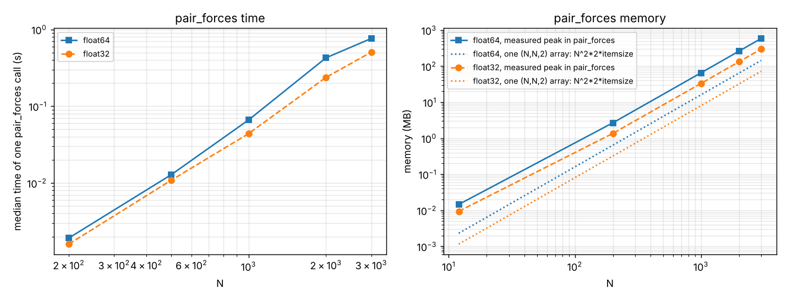

At N = 12 float32 gives no speedup. One step takes about 60 microseconds, which is almost all Python and NumPy call overhead, and that does not depend on the dtype. Float32 helps once the (N,N,2) arrays are large (N >= 1000), where moving the data through memory is the main cost. Even then the speedup is 1.4 to 1.8, not 2.

### 4.3 Trajectory difference and sensitivity

My first run went to t = 10 at dt = 0.01, and eps_pos only reached 3.8e-3 by the end. So I extended all runs to t = 40, and also ran dt = 0.001. Besides float32 vs float64, I ran float64 from the rounded start (start rounding only), five float64 runs with random 1e-7 relative kicks to the positions, and one with a 1e-12 kick.

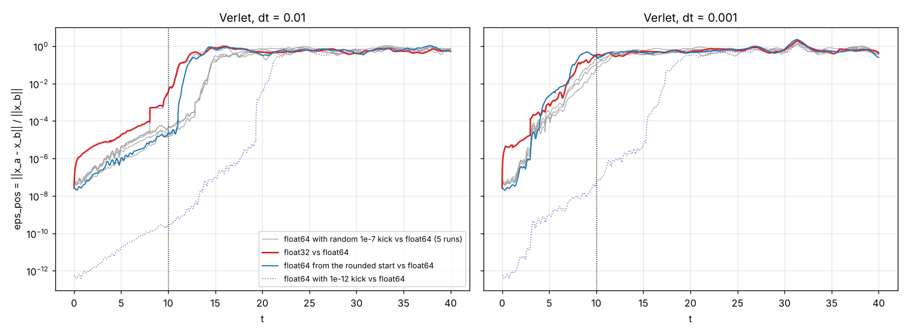

From `results/precision_accuracy.txt` (eps_pos at t = 1 / 10 / 40, and the first time eps_pos > 0.1):

| curve | dt = 0.01 | t(eps > 0.1) | dt = 0.001 | t(eps > 0.1) |
|---|---|---|---|---|
| float32 vs float64 | 2.0e-6 / 3.8e-3 / 0.53 | 11.17 | 5.1e-6 / 0.34 / 0.43 | 7.99 |
| float64 rounded start vs float64 | 3.9e-8 / 2.2e-5 / 0.55 | 12.10 | 3.5e-8 / 0.26 / 0.25 | 7.48 |
| float64, five 1e-7 kicks | 6.6e-8 to 9.6e-8 / 1.5e-5 to 3.8e-3 / 0.51 to 0.77 | 11.10 to 14.60 | 6.4e-8 to 8.2e-8 / 0.064 to 0.31 / 0.35 to 0.48 | 7.48 to 10.50 |
| float64, 1e-12 kick | 8.5e-13 / 2.6e-10 / 0.56 | 21.10 | 8.1e-13 / 4.5e-8 / 0.51 | 18.38 |

What I see:
- Float32 arithmetic adds more difference than the start rounding. By t = 1, eps_pos is 2.0e-6 compared with 3.9e-8 from the rounding alone, because every step rounds the positions again to about 6e-8 relative.
- After that, all curves grow at a similar rate and level off near eps_pos of about 0.5. That level means the two trajectories have nothing in common any more (particles are somewhere else in the box). Even a 1e-12 change in the start, far below float32 resolution, reaches the same level by t of about 18 to 21. So the large final eps_pos is sensitivity of the system (chaos), not a float32 problem. Float32 only starts the divergence from a larger seed, so it arrives a few time units earlier. At dt = 0.001, float32 crosses 0.1 at t = 7.99, inside the range 7.48 to 10.50 of the kicked float64 runs. At dt = 0.01 it is earlier than four of the five kicked runs (11.17 vs 11.10 to 14.60).
- The curves show sudden jumps (for example at t of about 8 for float32 at dt = 0.01). These happen when a pair crosses rc one step earlier or later in one run than in the other. The force jumps by 18 there, so a one-step timing difference becomes a big kick.

### 4.4 Quantities that do not depend on the exact trajectory (`results/precision_statistics.csv`)

| run (Verlet) | dt = 0.01, t <= 10: E_shift(10) / npairs(10) / mean K, t = 5 to 10 | dt = 0.001, t <= 40: E_shift(40) / eps(E_shift) / mean K, t = 20 to 40 |
|---|---|---|
| float64 | -52.50 / 33 / 132.21 | -46.75 / 0.0857 / 254.53 |
| float32 | -52.38 / 33 / 132.33 | -46.43 / 0.0717 / 205.95 |
| float64 rounded start | -52.48 / 33 / 132.21 | -50.16 / 0.0147 / 144.81 |
| five 1e-7 kicks (min to max) | -52.54 to -51.07 / 33 / 132.21 to 132.34 | -48.52 to -48.04 / 0.036 to 0.048 / 160.0 to 203.5 |
| 1e-12 kick | -52.50 / 33 / 132.21 | -46.60 / 0.0832 / 249.99 |

Over the handout run (dt = 0.01, t <= 10) the trajectories have not separated yet, and float32 agrees with the float64 runs in every quantity. Over t = 40, mean K, final pair count and E_shift drift differ a lot between float64 runs whose starts differ by 1e-7 or even 1e-12. Mean K ranges from 144.8 to 254.5, and the float32 value (205.95) is inside that range. The final float32 E_shift (-46.43) is 0.17 above the highest float64 value (-46.60), while the float64 runs themselves spread over 3.6. I do not see a systematic float32 effect in any of these.

### 4.5 Energy behaviour and round-off floor

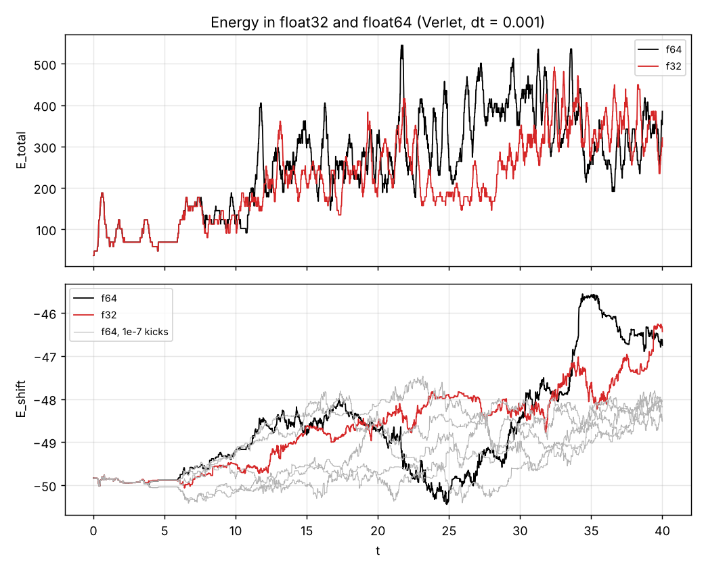
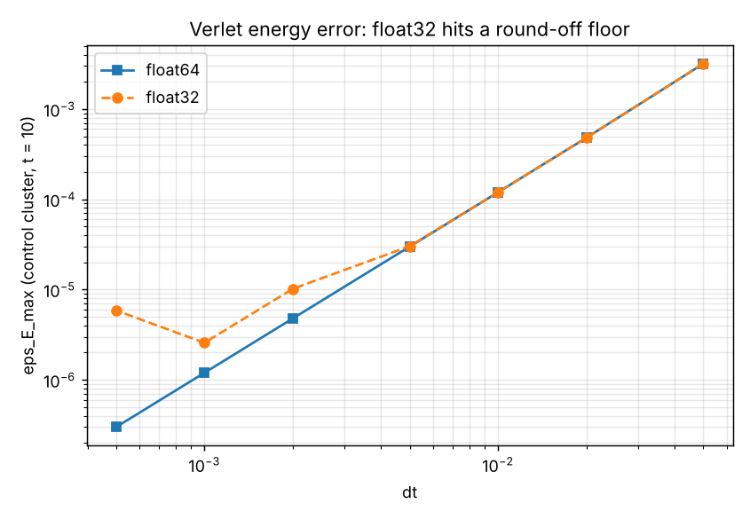

In the default run, E and E_shift look the same in both precisions until the trajectories separate. To see the pure round-off effect I reran control A (no crossings, no walls) in both precisions (`results/precision_control_eps_vs_dt.csv`). For dt >= 0.01 the two errors agree to three digits (dt = 0.01: 1.197e-4 vs 1.196e-4). Below that, float32 stops improving: 1.02e-5 vs 4.78e-6 at dt = 0.002, and 5.9e-6 vs 3.0e-7 at dt = 0.0005, where the float32 error even goes up again. Smaller steps mean more rounding of x + v dt, with smaller increments each time. This floor of about 1e-5 is about 1000 times below the 0.7 % cutoff error at my recommended dt, so it does not matter here.

### 4.6 Answer for Task 5

Float32 is accurate enough for this problem. Nothing we can trust in float64 (the statistics, energy drift and cluster size) changes beyond the float64 run-to-run spread, and the trajectory itself cannot be trusted beyond t of about 10 to 20 in either precision. Its advantage is memory: exactly half for every float array, and a 1.97 times smaller peak inside `pair_forces`. That means about 1.4 times more particles fit in the same memory with the (N,N,2) method. It also gives a 1.2 to 1.8 times speedup of `pair_forces` for N >= 200, and 1.4 to 1.5 times for whole steps at N >= 1000. At N = 12 it gives nothing (0.98). It also raises the energy floor and starts the divergence about 50 times earlier. For the N = 12 production runs I would keep float64, and use float32 only when memory limits a large-N vectorized run.

## 5. What I learned

- A conserved quantity only means something if it is the right one. The raw E_total in this model is not conserved by the exact dynamics. Without the shifted energy, the energy test would say every dt is wrong by 400 % or more.
- The order of an integrator only shows when the forces are smooth. Verlet's slope of 2 turns into about 1 as soon as there is a force jump (cutoff) or a position jump (wall clamp). To see the real integrator error I needed a control run without them.
- The timestep is limited by the model (cutoff and walls), not by the method. Fixing the model would buy far more than switching integrators.
- For a chaotic system, comparing trajectories between precisions only makes sense next to a float64-vs-float64 baseline with a tiny start change.
- Float32 only pays off when the arrays are big enough for memory traffic to matter.

## 6. Links to other members

- Member 1 (baseline): found the 10.8 jump at the cutoff. I reproduced it (slope 10.7959) and used `run`, `step_euler` and `step_verlet` from `toymodel.py` unchanged. No issue found in `toymodel.py`. The wall clamp and the non-zero U at rc come from the handout model, not from a coding error.
- Member 2 (efficiency, memory): my float32/float64 `pair_forces` timings and the factor of 4 between the peak memory and one (N,N,2) array connect to the Task 6 and 7 results in `../member2_forces_efficiency_memory`.
- Member 4 (dissipation): any energy criterion for relaxation should use E_shift. The raw E jumps by 10.8 whenever a bond forms or breaks, even with no drag.
- Member 5 (recommendation): Verlet, dt = 0.0005 for under 1 % shifted-energy drift (dt = 0.002 for under 5 %), float64 at N = 12. A smooth cutoff and an exact wall mirror could allow dt of about 0.05.
