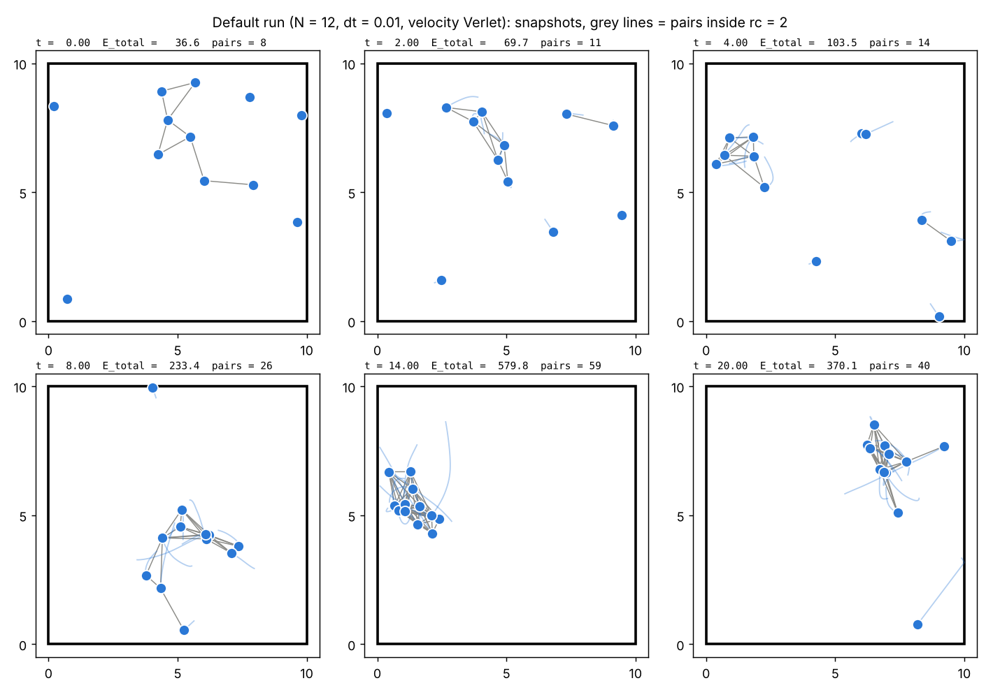
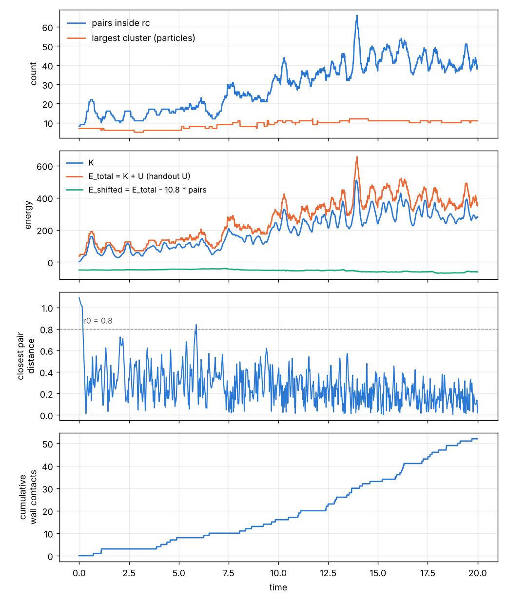
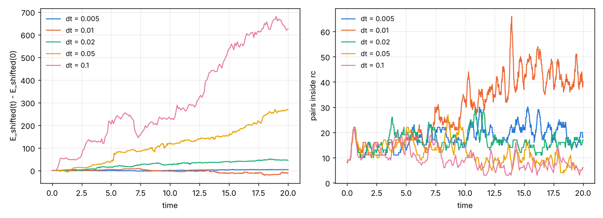
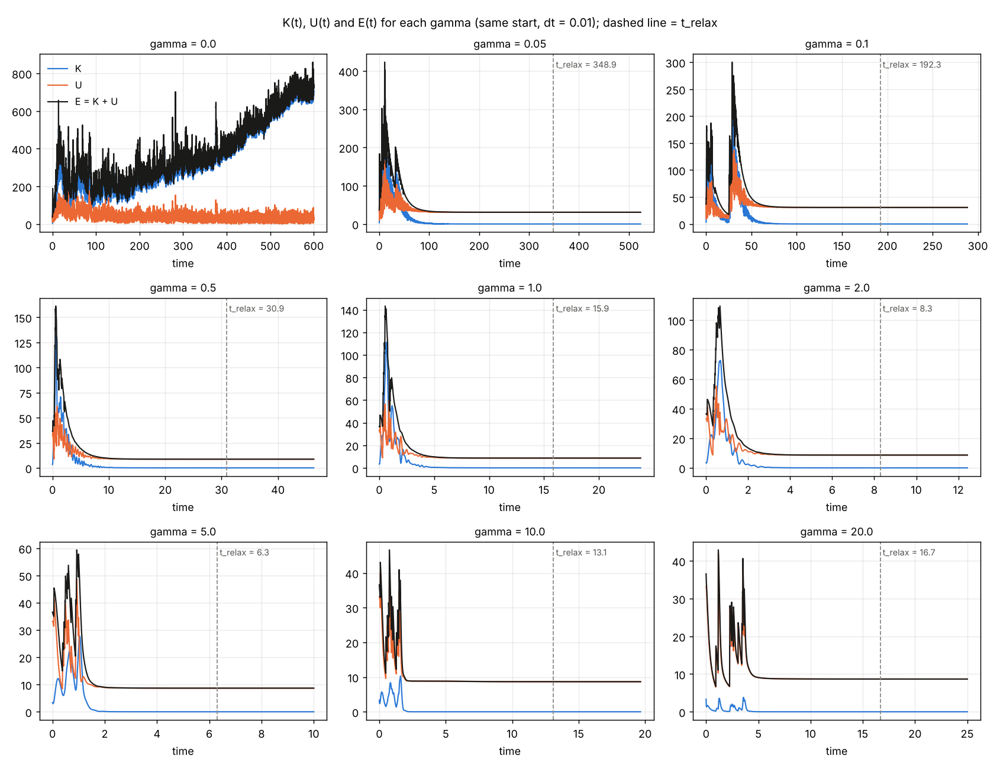
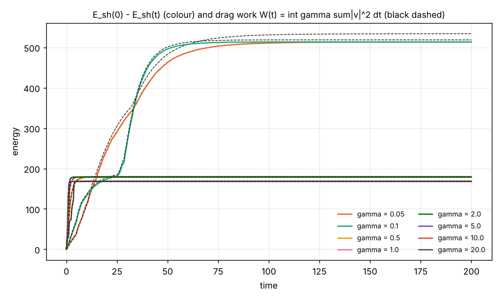
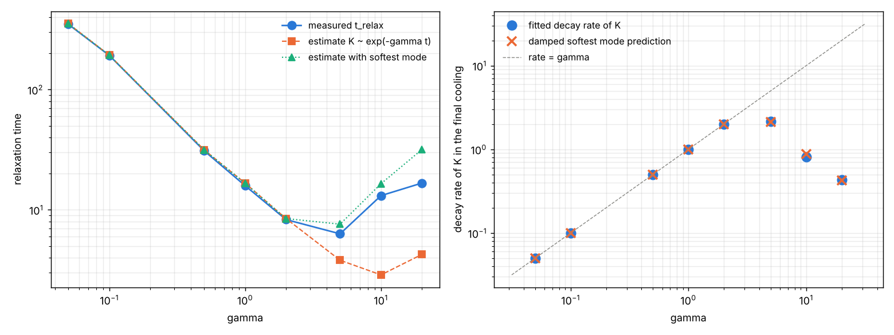
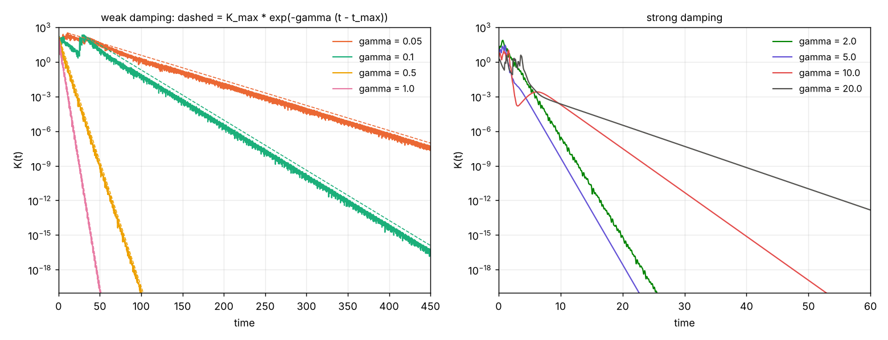
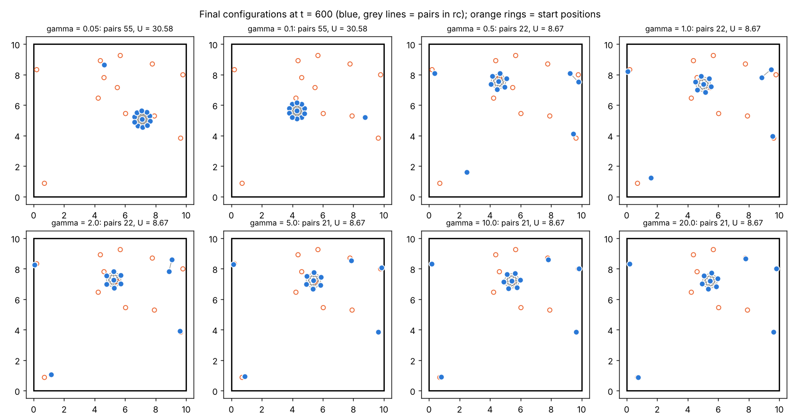
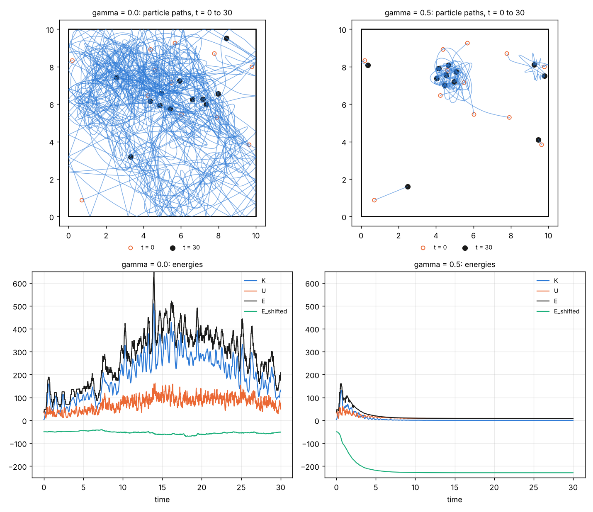

# Animation, diagnostics and dissipation in the 2D atomic toy model
Member 4: animation and visualization (Task 2), dissipation and relaxation (Task 4)

## 1. What I did

I made the trajectory animation of the default system and then used it as a diagnostic, checking each thing I saw in the movie against numbers from the trajectory. For Task 4 I added a viscous drag force F_drag = -gamma v. Then I checked the energy balance, defined a steady-state criterion, and measured how gamma changes both the relaxation time and the final state. All runs start from the shared initial condition (`tm.init_system`, N = 12, L = 10, seed 0) and use Member 1's `toymodel.py` for forces, distances and energies (see [Member 1's report](../member1_baseline_verification/report.md)).

Scripts (all in this folder):
- `damped.py`: damped velocity Verlet step, pair bookkeeping (pair count, shifted energy) and cluster finder (connected components of the neighbour graph).
- `animate_default.py`: Task 2 animation, snapshots, diagnostics and the large-dt runs.
- `dissipation.py`: Task 4 runs for 9 values of gamma, energy balance, relaxation table and figures.
- `compare_animation.py`: side-by-side movie of gamma = 0 vs gamma = 0.5.
- `stepper_check.py`: tests the damped stepper against the exact damped oscillator.
- `wall_check.py`: tests how much energy error comes from the wall handling.

## 2. Task 2: animation and what it shows

The default run is 2000 velocity Verlet steps with dt = 0.01 (t = 0 to 20). The box is drawn as a thick black square. Particles are blue dots with a short trail (0.3 time units). Pairs inside rc = 2 are joined by thin grey lines, and the time, E_total and pair count are printed above the box.

- `results/animation_default.mp4`: every 4th step, 501 frames, 3.12 MB
- `results/animation_default.gif`: every 8th step, 251 frames, 1.61 MB
- `results/animation_dt0.1.mp4` / `.gif`: same start with dt = 0.1, as an example of a bad run

My own stepper with gamma = 0 gives exactly the same positions as `tm.run` (max difference 0.0, `results/animate_log.txt`), so the movie shows Member 1's simulator.

The checks I did (numbers from `results/diagnostics_dt.csv`, `results/default_summary.txt`, `results/default_wall_runs.csv`):

| Check | How measured | Default run (dt = 0.01) |
|---|---|---|
| Particles escaping | min / max coordinate over all steps | 0.0 / 10.0 |
| Stuck at a wall | longest run of consecutive steps a particle sits on a wall | 1 step (all 12 particles), 52 wall contacts in total |
| Unrealistic jumps | max over all steps of displacement / (speed * dt) | 1.025 (max displacement 0.1693, max speed * dt 0.1693) |
| Instability | max abs drift of the shifted energy | 21.06 (42% of abs E_shifted(0) = 49.83) |
| Clustering | pair count, largest cluster | pairs 8 to 40 (max 66 at t = 13.95); largest cluster 7 to 11 |
| Overlap | closest pair distance | 0.0037; a pair closer than 0.1 in 11.1% of steps |

So the box and the walls behave well. What the movie mainly shows is that the particles pull together into one dense, hot cluster: from t = 10 on, the largest cluster has 10 or more particles in 97.6% of the steps. At t = 13.95 all 66 possible pairs are inside rc, so every particle is within 2 of every other one. Particles inside the cluster often sit almost on top of each other.

**Why it clusters.** For a pair inside rc the handout energy is U_ij = 0.5 k (r - r0)^2. At r = rc this is 0.5 * 15 * 1.2^2 = 10.8, not 0, and the force drops from 18 to 0 there. The force is the gradient of the shifted potential phi(r) = 0.5 k (r - r0)^2 - 10.8 (zero outside rc). That potential is a well 10.8 deep at r0, and even at r = 0 it is still -6.0, because the barrier against overlap is only 0.5 k r0^2 = 4.8. So every pair that moves inside rc lowers the potential energy, even if the two particles overlap completely. The initial kinetic energy (3.34 for all 12 particles) is tiny compared with the well depth, so this is like a cold gas that condenses. Each new bond releases up to 10.8 of energy into kinetic energy, which is why K goes from 3.34 to 280.4 by t = 20.

The bookkeeping checks out: 10.8 * (40 - 8) - (U(20) - U(0)) = 345.6 - 56.5 = 289.1. The measured K(20) - K(0) is 277.1, and the difference of 12.0 is the drift of E_shifted (-49.83 to -61.85). E_total from the handout formula goes from 36.57 to 370.1 only because it leaves out the -10.8 per pair.

Two particles alone cannot form a bond. In `results/two_particle_capture.csv` two particles are sent toward each other (relative speed 0.2). They spend 0.82 time units inside rc and then separate again. Head on (b = 0) they pass straight through each other (closest distance 0.0005, particle 0 goes from x = 3.5 to x = 6.51). With an offset of b = 0.5 the closest distance is still 0.020. So clustering needs three or more particles, so that a third particle can carry away the released energy. It is not a bug in the code: it is what this force law does. If the model is meant to describe atoms that keep their distance, it needs a force that goes to zero smoothly at rc and a proper repulsive core.

**A bad run.** With dt = 0.1 the same start looks very different (`results/animation_dt0.1.mp4`, `results/diagnostics_dt.png`). Particles move in long straight lines, a single step can be 2.21 long (longer than rc, so a particle can jump across a neighbour's whole well in one step), and E_shifted rises by up to 680.8 within t = 20. The extra energy boils the cluster apart: only 6 pairs are left at t = 20. dt = 0.05 is similar (+270.3). Even at dt = 0.02 the drift is 51.3, against 4.4 at dt = 0.005. Without the energy numbers, the dt = 0.1 movie could pass for a normal hot gas, which is why we checked it numerically. Choosing dt is covered in more detail in [Member 3's report](../member3_energy_precision/report.md).

## 3. Task 4: dissipation

### 3.1 Integrator

`force_fn` in `toymodel.py` only takes positions, so I wrote my own step in `damped.py`. With a = gamma dt / (2m):

    v_half = v (1 - a) + (dt/2m) F(x)               # drag with the old velocity
    x_new  = x + v_half dt, then wall reflection (tm.walls_reflect)
    v_new  = (v_half + (dt/2m) F(x_new)) / (1 + a)  # drag with the new velocity (implicit)

Because the drag is linear in v, the implicit second half-kick is just one division, with no iteration. The two half-kicks together use the trapezoidal rule for the drag term. For gamma = 0 the step is exactly velocity Verlet. The drag factor (1 - a)/(1 + a) stays between 0 and 1 for any gamma < 2/dt, so even gamma = 20 (a = 0.1) is no problem.

I checked the step on a single pair that stays inside rc (r(0) = 1.2, gamma = 0.5), where the exact solution is a damped oscillator with omega0^2 = 2k (`results/stepper_check.csv`). Halving dt lowers the error by a factor of 3.95, 3.99, 4.00 and 4.00, so the scheme is second order like plain Verlet.

### 3.2 Runs

The values were gamma = 0, 0.05, 0.1, 0.5, 1, 2, 5, 10, 20. Every run used the same start, dt = 0.01 and 60000 steps (t = 600). I added 1, 2, 5, 10 and 20 after the first runs showed that the relaxation time stops falling somewhere between 2 and 10.

For gamma = 0, E keeps growing over the whole run (36.57 to 742.7 at t = 600) instead of staying flat; section 4 explains this. For gamma > 0, K first jumps up as the bonds form, and then everything decays to a constant E = U.

### 3.3 Energy balance

With drag, dE_mech/dt = -gamma sum |v|^2. I checked this with the shifted energy E_sh = K + sum over pairs inside rc of [0.5 k (r - r0)^2 - 10.8], which is continuous when a pair crosses rc. The drag work W(t) is the integral of gamma sum |v|^2 dt, computed with the trapezoidal rule over every step (`results/energy_balance.csv`).

| gamma | drop of E_sh | drag work W | mismatch | mismatch / W | part of the mismatch on steps where a pair crosses rc |
|---|---|---|---|---|---|
| 0.05 | 513.58 | 533.81 | 20.23 | 3.8% | 18.09 |
| 0.1 | 513.58 | 518.69 | 5.11 | 0.98% | -0.44 |
| 0.5 | 179.09 | 180.53 | 1.44 | 0.79% | 1.46 |
| 1 | 179.09 | 179.82 | 0.72 | 0.40% | 0.77 |
| 2 | 179.09 | 178.51 | -0.59 | -0.33% | -0.49 |
| 5 | 168.29 | 167.97 | -0.33 | -0.20% | -0.16 |
| 10 | 168.29 | 168.00 | -0.30 | -0.18% | -0.09 |
| 20 | 168.29 | 168.45 | 0.16 | 0.09% | 0.36 |

The balance holds to within 1% for gamma >= 0.1, and to 3.8% for gamma = 0.05. That run stays hot for the longest and has the most cutoff crossings (638), and 18.09 of its 20.23 mismatch comes from those steps. The unshifted E cannot be used for this check: for gamma = 0.05 it drops by only 5.98 while the drag removed 533.8, because every new pair adds +10.8 to U.

To check that the mismatch is a timestep error, I repeated gamma = 0.1 up to t = 100 with smaller dt (`results/energy_balance_dt.csv`). The summed absolute per-step mismatch falls from 582.7 (dt = 0.02) to 174.2, 33.3 and 27.4 (dt = 0.0025). The signed relative mismatch is 6.75%, 0.98%, 0.20% and -0.68%, which is not monotonic. The trajectories are chaotic, so each dt gives a different history with a different number of cutoff crossings (457, 342, 171 and 317).

### 3.4 Steady-state criterion

A state counts as steady from time t_relax on if both conditions hold at every saved time from t_relax to the end of the run:

1. mean particle speed < 1e-3, and
2. |E(t + DeltaT) - E(t)| / |E(0)| < 1e-3 with DeltaT = 10 time units (1000 steps),

and the run must continue for at least 100 time units after t_relax.

Why both conditions: the energy test alone is too weak for small gamma. With drag, |E(t + DeltaT) - E(t)| is about 2 gamma <K> DeltaT, so the 1e-3 limit (0.0366 here) still allows <K> up to about 0.0018/gamma, which for gamma = 0.05 means particles visibly moving at about 0.08. The speed test is much stricter: the initial mean speed is 0.665, so 1e-3 is about 1/700 of it. DeltaT = 10 is longer than the slowest vibration period of the final clusters (2 pi / omega_min = 3.07, see below), so a single K to U oscillation cannot pass the test by luck.

I first wrote the energy test exactly as in the assignment, |E(t) - E(t - DeltaT)|. That labels a window by its end, which added about 10 to t_relax for strong damping (gamma = 5 came out at 13.2 instead of 6.3). So I now label the window by its start. The last 10 time units of the run cannot be tested this way, and there only the speed condition is checked.

### 3.5 Relaxation time and final state

From `results/relaxation_table.csv`. "Final" means t = 600. Clusters are connected components of the pairs inside rc.

| gamma | t_relax | energy test alone | K decay rate (fit) | predicted rate | t_relax from exp(-gamma t) | final E (= U) | final E_sh | pairs | cluster sizes |
|---|---|---|---|---|---|---|---|---|---|
| 0 | never | never | - | - | - | 742.68 (U = 36.02) | 634.68 | 10 | 5 2 2 1 1 1 |
| 0.05 | 348.94 | 168.9 | 0.0502 | 0.05 | 352.7 | 30.585 | -563.42 | 55 | 11 1 |
| 0.1 | 192.26 | 107.11 | 0.1001 | 0.1 | 193.0 | 30.585 | -563.42 | 55 | 11 1 |
| 0.5 | 30.91 | 16.3 | 0.5005 | 0.5 | 31.5 | 8.672 | -228.93 | 22 | 7 2 1 1 1 |
| 1 | 15.87 | 8.45 | 1.0004 | 1 | 16.7 | 8.672 | -228.93 | 22 | 7 2 1 1 1 |
| 2 | 8.29 | 4.49 | 1.998 | 2 | 8.45 | 8.672 | -228.93 | 22 | 7 2 1 1 1 |
| 5 | 6.31 | 3.22 | 2.139 | 2.128 | 3.81 | 8.672 | -218.13 | 21 | 7 1 1 1 1 1 |
| 10 | 13.11 | 7.55 | 0.816 | 0.876 | 2.88 | 8.672 | -218.13 | 21 | 7 1 1 1 1 1 |
| 20 | 16.68 | 8.70 | 0.434 | 0.423 | 4.25 | 8.672 | -218.13 | 21 | 7 1 1 1 1 1 |

How the columns were computed:

- **Fitted rate:** the slope of ln K between the last change of the pair set and the point where K falls to 1e-14.
- **"t_relax from exp(-gamma t)":** assumes K decays like exp(-gamma t), so the mean speed decays like exp(-gamma t / 2), starting from the last pair change.
- **Predicted rate:** I computed the Hessian of the final configuration by finite differences of `tm.pair_forces` and took the softest non-zero vibration omega_min. It is 3.46 for the 11-cluster and 2.05 for the 7-cluster. A damped mode loses kinetic energy at rate gamma if gamma < 2 omega_min, and at rate gamma - sqrt(gamma^2 - 4 omega_min^2) if it is over-damped.

The lowest Hessian eigenvalue at every final state is between -3.2e-5 and -2e-10, which is zero within the finite-difference error. So the final states are real local minima and not saddle points that only look still.

**How gamma affects the relaxation time.**
- For gamma up to 2 the clusters are under-damped, and K decays exactly like exp(-gamma t): the fitted rate divided by gamma is 1.004, 1.001, 1.001, 1.000 and 0.999. So the simple estimate predicts t_relax to within about 5% (348.9 vs 352.7 for gamma = 0.05), and t_relax * gamma stays between 15.5 and 19.2.
- Above about 2 omega_min = 4.1 the motion is over-damped. The softest mode then creeps back slowly, at a rate of about 2 omega_min^2 / gamma, so relaxation gets slower again: t_relax = 6.31, 13.11 and 16.68 for gamma = 5, 10 and 20.
- The simple exp(-gamma t) estimate fails in this regime (it gives 2.9 to 4.3). The mode prediction gets the decay rate right (0.423 vs 0.434 fitted for gamma = 20). It gets t_relax less well (31.7 vs 16.7), because the starting speed is not all in the slowest mode.
- The fastest relaxation is close to critical damping, between gamma = 2 and 10 (the best of our values is gamma = 5).

**How gamma affects the final state.**
- With weak drag (0.05, 0.1) the system first heats up (K_max = 320.5 and 213.2), moves around the box and ends as one 11-particle cluster: 10 around a centre particle, all 55 pairs inside rc, with E_sh = -563.4.
- With strong drag the energy is removed before the particles get anywhere. The 7 particles that were already connected at t = 0 collapse into a hexagon around a centre (21 pairs), and the isolated particles stay close to where they started (`results/final_states.png`). E_sh is then only -228.9 (gamma 0.5 to 2, with one extra pair at r0) or -218.1 (gamma >= 5).

So small gamma behaves like slow annealing: it finds a much lower energy minimum but needs a long time. Large gamma behaves like a quench: it gets stuck in the nearest minimum. For gamma = 0 the system never relaxes: the mean speed at t = 600 is still 9.94.

### 3.6 Conservative vs dissipative

`results/compare_gamma0_vs_gamma0.5.mp4` shows both runs side by side for t = 0 to 40.
- With gamma = 0 the particles cross the whole box many times within t = 30 and the cluster keeps breaking and re-forming.
- With gamma = 0.5 the particles move a short distance and then stop: K falls to 1.02 by t = 8, and E_sh drops from -49.8 to -228.9.

## 4. Wall handling in toymodel.py (comes from the handout)

The gamma = 0 run up to t = 600 heats up steadily: E_sh goes from -49.83 to 634.68. I split the per-step change of E_sh by what happened in that step (`results/energy_error_breakdown_gamma0.csv`):

| Step type | Total change of E_sh |
|---|---|
| a pair crossed rc | +215.8 |
| a pair closer than 0.1 | +38.8 |
| a particle on a wall (and neither of the above) | +430.3 |
| all other steps | -0.39 |

`walls_reflect` (as in the handout) puts a particle that went past the wall exactly back onto the wall and flips its velocity. If the particle feels a spring force, the position it loses changes U without any matching change in K.

`wall_check.py` compares this clamp with a mirror reflection (a particle that went a distance delta past the wall is put delta inside). Over 600 time units at dt = 0.01, the mirror version gains +46.0 in E_sh, against +684.5 with the clamp (max abs drift 58.5 vs 699.4). At dt = 0.005 the numbers are 92.7 vs 186.5 at the end of the run (`results/wall_handling_check.csv`).

In a controlled test, I threw 200 bonded pairs at a wall once each. The clamp adds +0.147 to E_sh on average per hit; the mirror adds -0.014 (mean absolute change 0.198 vs 0.148, `results/wall_pair_test.csv`). So the clamp has a systematic upward bias, and the mirror does not. This matters for long conservative runs, but hardly at all for the dissipative runs, where particles stop hitting the walls once they cool down. I did not change `toymodel.py`; `damped.walls_mirror` is available if the group wants to switch (see [Member 5's recommendation](../member5_innovation_recommendation/recommendation.md)).

## 5. What I learned

- The animation showed the clustering straight away, but I could only explain it with numbers: the pair count, the cluster sizes and the shifted energy. A dt = 0.1 movie still looks like a plausible gas, and only the energy shows it is wrong.
- For a model with a discontinuous cutoff, the handout's E_total is the wrong quantity to check. E_shifted is the conserved one, and the drag balance only closes with it.
- The relaxation time is not simply "bigger gamma, faster": it has a minimum near critical damping. And the final state itself depends on gamma, which I did not expect before running it.
- A steady-state test based only on energy changes can call a system steady while it is still visibly moving. Adding the speed condition fixed this.
