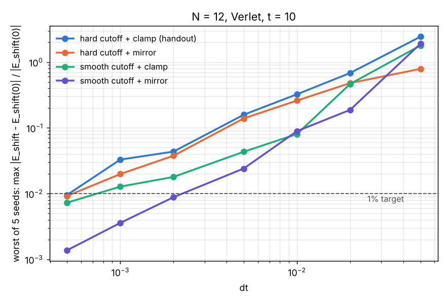

# Final computational engineering recommendation (Task 9)
Member 5 (Rakesh, MS26BTECH11014), using the results of all five members

## How we decided

We chose each setting on three things: accuracy, run time and memory. For accuracy we use Member 3's target: the shifted energy E_shift = K + U - 10.8 · npairs must drift by less than 1% of |E_shift(0)| over t = 10, for every one of 5 seeds (seeds 0 to 4).

We cannot use the raw E_total for this. U(rc) = 0.5 · 15 · 1.2² = 10.8, so E jumps by 10.8 whenever a pair crosses the cutoff (Member 1; Member 3 fitted a slope of 10.7959 per pair). The raw drift is 400% to 1000% at every dt (Member 3, Table 1), so it says nothing about the integrator.

All timings were taken on the same shared 4-core machine and are medians.

### New measurements made for this recommendation

Member 3 suggested that a smooth cutoff plus an exact mirror at the walls might allow a much larger dt, but nobody had tested it. I tested it with `recommend_tests.py`:
- **Smooth cutoff.** The shifted pair potential is multiplied by a quintic switch that goes from 1 at r = 1.5 to 0 at r = 2. Both U and F are then 0 at rc, and for r < 1.5 the force is exactly the handout force.
- **Mirror walls.** A particle that went δ past a wall is put δ inside, instead of being clamped onto the wall.

First, the checks (`results/recommend_checks.txt`):
- The hard version reproduces tm.pair_forces to 1.3e-10.
- The smooth force equals -dU/dx (finite differences) to 7.9e-7.
- My stepper reproduces tm.run (positions differ by 6.2e-10 after 1000 steps) and gives Member 3's drift of 0.1859 at dt = 0.01.

Worst seed of 5, N = 12, Verlet, t = 10 (`results/dt_study_models_summary.csv`):

| model | dt = 0.01 | dt = 0.005 | dt = 0.002 | dt = 0.0005 | largest dt for < 1% | largest dt for < 5% |
|---|---|---|---|---|---|---|
| hard cutoff + clamp (handout) | 32.4% | 15.8% | 4.35% | 0.96% | 0.0005 | 0.002 |
| hard cutoff + mirror | 26.0% | 13.9% | 3.76% | 0.92% | 0.0005 | 0.002 |
| smooth cutoff + clamp | 8.0% | 4.33% | 1.79% | 0.73% | 0.0005 | 0.005 |
| smooth cutoff + mirror | 8.9% | 2.41% | 0.88% | 0.14% | **0.002** | 0.005 |

Fixing both the cutoff and the walls lets dt grow by a factor of 4 (0.0005 to 0.002) at the 1% target. That is much less than the factor of about 100 we hoped for from Member 3's control run, where Verlet stays at 0.32% even at dt = 0.05. The worst-seed drift of the smooth model still falls only like dt^1.35, not dt². So something else in the model is still not smooth. A likely candidate is the spring force at r → 0, which suddenly changes direction when two particles pass through each other, but I did not test this.

The smooth cutoff also changes the model: the well is shallower between r = 1.5 and 2, and E_shift(0) for seed 0 is -43.69 instead of -49.83. The particles still cluster (the median final pair count is 16 to 28 across dt, against 17 to 29 for the hard cutoff).

At larger N with the cell list (seed 0, t = 10, `results/large_N_check.csv`):

| N | handout model, dt = 0.01 | handout model, dt = 0.0005 | smooth + mirror, dt = 0.01 | smooth + mirror, dt = 0.02 | time per step (smooth, dt = 0.01) |
|---|---|---|---|---|---|
| 1000 | 7.2% | 0.16% | 0.41% | 2.9% | 0.15 ms |
| 10000 | 3.8% | 0.018% | 0.30% | 4.6% | 1.35 ms |

These are single seeds, so they are weaker evidence than the 5-seed N = 12 table. The relative drift is smaller than at N = 12, probably because |E_shift(0)| grows with N while the errors of different crossings partly cancel.

## The recommendation

| item | handout system (N = 12, L = 10) | large N (fixed density 0.12, N of 1000 or more) |
|---|---|---|
| precision | float64 | float64 |
| integrator | velocity Verlet | velocity Verlet |
| dt | 0.0005 (0.002 if 5% drift is enough) | 0.0005 with the handout model; 0.01 with the smooth cutoff + mirror walls |
| force method | `tm.pair_forces` (NumPy) for single runs; the Numba version for long studies | Numba cell list (`cellforces.pair_forces_cell`) |
| cutoff | rc = 2, hard, as in the handout; always report E_shift | rc = 2; smooth switch from 1.5 to 2 if the model may be changed |
| walls | clamp (handout) for the reported results; mirror for long runs | mirror |
| drag γ | 0 for dynamics; 5 for a fast quench; 0.1 to find the low-energy cluster | not tested at large N |
| innovation | not needed | cell list + Numba |

### Precision: float64

- **N = 12.** float32 gives no speedup (a 1000-step run takes 0.0597 s against 0.0610 s, ratio 0.98, Member 3), and the arrays are tiny (pos is 192 bytes in float64, Member 1). Its accuracy would be good enough: Member 3 found that the float32 trajectory diverges no faster than float64 runs whose start differs by 1e-7. But there is nothing to gain from it.
- **Large N.** float32's real advantage is halving the 65 N² byte peak of the NumPy force (Members 2 and 3, a 1.2x to 1.8x speedup at N >= 1000). With the cell list that peak is gone: memory is 40.6 bytes per particle (41 MB at N = 10^6). The cell-list force in float32 is only 0.99x to 1.12x as fast as float64 for N = 1000 to 10^6, and slower at N = 12 (0.47x) (`results/cell_precision_cost.csv`). So float32 buys nothing once we use the cell list.

### Integration method: velocity Verlet

- **Smooth case.** In Member 3's control run without cutoff crossings, Verlet is second order (slope 2.001) and Euler first order (1.024). At dt = 0.01 Euler's error is 23 times larger (2.73e-3 against 1.20e-4).
- **Handout model.** The cutoff jump reduces both methods to about first order, but Verlet still allows twice the dt: it passes 1% at dt = 0.0005 (worst seed 0.956%), and Euler fails there (1.26%).
- **Cost.** Both need one force call per step, so Verlet's advantage is free.
- **With drag.** Use Member 4's damped Verlet, which has an implicit second half-kick. It is still second order (the error ratio is 4.00 when dt is halved).

### Timestep

- **Handout model.** dt = 0.0005 is the largest dt that meets the 1% target for all 5 seeds (Member 3, and reproduced in my table above). The handout value dt = 0.01 drifts by 18.6% for seed 0 and up to 32.4% over the 5 seeds, so we cannot defend it. At N = 12 the cost of dt = 0.0005 is small: a t = 10 run is 20000 steps and took 1.39 s through `tm.run` (Member 3).
- **Large N, handout model.** We keep dt = 0.0005. dt = 0.01 drifted by 7.2% at N = 1000, and I did not test the values in between. At N = 10000 one t = 10 run is then 20000 × 1.27 ms ≈ 25 s with the cell list.
- **Large N, smooth cutoff + mirror.** If the model may be changed, dt = 0.01 stays under 1% at N = 1000 and 10000 (0.41%, 0.30%). That is 1000 × 1.35 ms ≈ 1.4 s for the same N = 10000 run, 20 times fewer steps.
- **Dissipative runs.** For runs where only the relaxed state matters, dt = 0.01 is acceptable: Member 4's drag energy balance closes within 1% for γ >= 0.1 at that dt.

### Force calculation method

- **N = 12.** Keep `tm.pair_forces`. A whole 1000-step handout run takes 0.057 s with it (`results/run12_timing.csv`).
  - The Numba cell list is 20.9x faster per call, but compiling costs 0.90 s. That is paid back only after about 53,000 steps at N = 12 (`results/summary.txt`).
  - For a long study it does pay off. A dt study with 5 seeds and 7 timesteps is 193,500 steps per model; my four-model study above was 774,000 steps.
  - The plain Python loop is not a worse choice than NumPy at this density (NumPy is 0.94x the loop at N = 1000, Member 2), but neither is needed.
- **Large N.** Use the Numba cell list.
  - Speedup over `tm.pair_forces`: 853x per call at N = 1000 and 4171x at N = 5000; 513x for a whole 200-step run at N = 1000.
  - Scaling: time grows like N^1.10, against N^2.18 for NumPy.
  - Compared with Member 2's C -O2 loop at N = 1000 (0.375 ms), the cell list (0.072 ms) is 5 times faster, and its cost grows like N instead of N².
  - The NumPy force becomes impractical at about N = 5000 for time and N ≈ 8770 for our 5 GB limit (Member 2). The cell list does N = 10^6 in 0.19 s per call.

### Cutoff radius: keep rc = 2

- **Keep the value 2.** All verification and studies were done with rc = 2, which is 2.5 r0 and covers the whole well. A larger cutoff costs more: at N = 1000, rc = 3.3 gives 1984 pairs against 728 for rc = 2 (`results/force_check.csv`), and the cell-list work grows with rc². None of our results needed a longer range.
- **What must change is how the energy is reported.** Every energy check must use E_shift, not E_total. Shifting U does not change the dynamics, only the bookkeeping.
- **Smoothing the cutoff** is the one model change that measurably helps the timestep: 4x at N = 12 and 20x at the large-N check (with mirror walls). But it changes the model between r = 1.5 and 2. So we keep the hard cutoff for the results that answer the assignment, and recommend the smooth version only for large-N production runs where the model is ours to choose.

### Walls

The handout clamp adds energy. In Member 4's 600-time-unit run, E_sh rose by +684.5 with the clamp against +46.0 with a mirror. In single wall hits the clamp adds +0.147 on average and the mirror -0.014.

At N = 12 over t = 10 the mirror does not change the dt that meets 1% (0.0005 either way), but it lowers the median drift at dt = 0.01 from 18.6% to 8.5%. We keep the clamp for the assignment runs (it is the handout rule) and recommend the mirror for any long or large run.

### Dissipation parameter γ (Member 4)

- **γ = 0** for all energy and timestep work.
- **γ = 5** to relax quickly to the nearest minimum. It gave the shortest t_relax, 6.31; γ = 2 is close (8.29). Above about 2 ω_min ≈ 4.1 the motion is over-damped and relaxation slows again (13.11 at γ = 10, 16.68 at γ = 20).
- **γ = 0.1** to find the low-energy structure. It anneals into the 11-particle cluster with E_sh = -563.4, against -228.9 or higher at γ >= 0.5, but needs t_relax = 192.3.
- **Steady state:** Member 4's criterion (mean speed < 1e-3 and |ΔE|/|E0| < 1e-3 over ΔT = 10).
- We did not test γ at large N.

### Innovation

For N = 12, the innovation is not needed. For any study with more than about 40 to 100 particles, it is what makes the study possible. Details are in [report.md](report.md).

## Final question: what did we change, why, and did it help?

- **We changed the force evaluation** from the (N, N, 2) NumPy arrays to a cell-linked list compiled with Numba.
  - *Why:* the handout force needs 65 N² bytes and its time grows like N^2.18. At our density only about 1.5 neighbours per particle actually interact.
  - *Did it help?* Yes, for N above about 40. It is 853x faster per call at N = 1000 and 513x for a whole run. Memory is 7981x smaller at N = 5000, and N = 10^6 runs at 0.19 s per force call. The forces agree with the loop version to 3e-14.
  - *Where it did not help:* the handout system itself. For N = 12 a single run is faster without it, because compiling takes 0.9 s and the whole NumPy run takes 0.057 s.
- **We changed the energy diagnostic and the timestep.** We report E_shift instead of E_total, and use Verlet at dt = 0.0005 instead of 0.01.
  - *Why:* E_total jumps by 10.8 at every cutoff crossing, and dt = 0.01 drifts by up to 32% even in E_shift.
  - *Did it help?* Yes: the drift is below 1% for all 5 seeds, at 1.39 s per N = 12 run.
- **We tested a smooth cutoff with mirror walls.**
  - *Did it help?* Partly. It allows a 4x larger dt at N = 12, and dt = 0.01 stays under 1% at N = 1000 and 10000. But the gain was much smaller than the factor of 100 we expected, and it changes the model, so we offer it only as an option for large-N runs.
