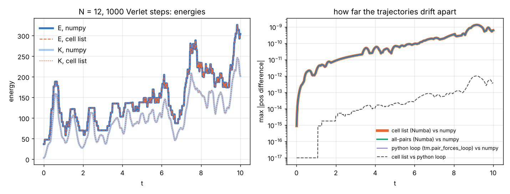
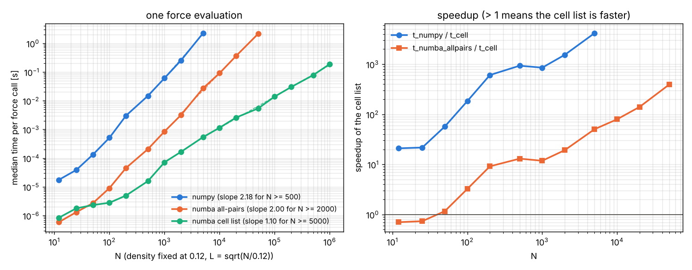
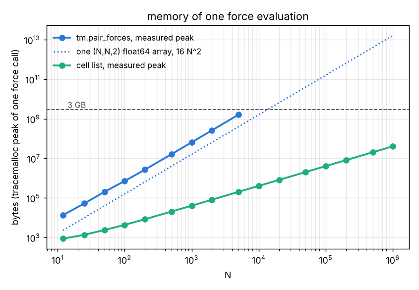
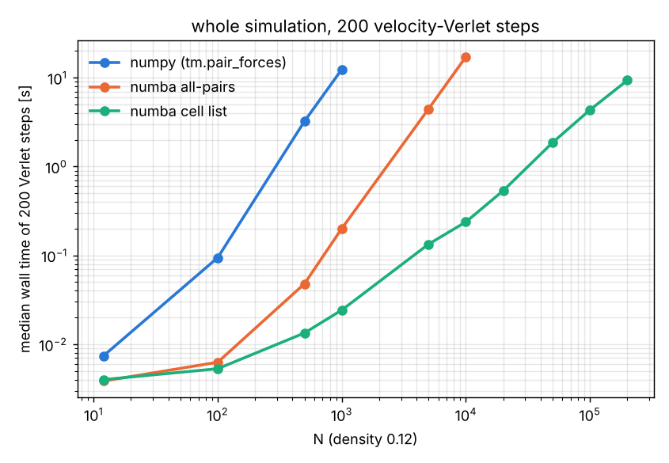

# Innovation: cell-linked neighbour list with Numba JIT
Member 5 (Rakesh, MS26BTECH11014): innovation (Task 8) and final recommendation (Task 9)

## What I did

The handout force `tm.pair_forces` builds the full (N, N, 2) displacement array. That makes the cost O(N²) in both time and memory, even though at the handout density (12 particles in a 10 x 10 box, so 0.12 per unit area) a particle has only about 1.5 partners inside rc = 2. I replaced the all-pairs search with a cell-linked list and compiled it with Numba. To separate "compiling helps" from "a better algorithm helps", I also wrote a compiled all-pairs loop. That gives three versions:

| version | algorithm | where |
|---|---|---|
| numpy (baseline) | all pairs, (N,N,2) arrays | `tm.pair_forces` (Member 1) |
| numba all-pairs | all pairs, double loop j > i, no big arrays | `cellforces.pair_forces_allpairs` |
| numba cell list | own cell + 8 neighbour cells | `cellforces.pair_forces_cell` |

The physics is unchanged: F = -k (r - r0) r̂ for 0 < r <= rc, with k = 15, r0 = 0.8, rc = 2.

## Method

**Cell list.** The box is cut into ncell x ncell cells, with ncell = floor(L / rc), so the cell side L / ncell is at least rc. Any partner within rc must then be in the particle's own cell or one of the 8 cells around it. I store the cells as linked lists: `head[c]` is the first particle in cell c and `nxt[i]` is the next particle in the same cell. For each particle i, I walk the (up to) 9 cells and only treat j > i. Newton's third law gives the force on j, so each pair is counted once.

The expected number of candidates per particle is 9 · ρ · side² ≈ 9 · 0.12 · 4 = 4.3, independent of N. So the work is O(N), against N(N-1)/2 pair checks for all-pairs.

Two details mattered:
- **Hard walls.** The box has hard walls and no periodic images, so edge cells simply have fewer neighbour cells (index ranges clipped to [0, ncell-1]).
- **Particles on the wall.** `walls_reflect` puts particles exactly on x = L or y = L. That gives a cell index of ncell, one past the grid, so the index is clamped to ncell - 1.

I kept the same cutoff test as the handout (`r > 0 and r <= rc`, using the square-rooted distance) so that pairs at exactly r = rc are treated the same way.

**Fixed density scaling.** For every N the box is L = sqrt(N / 0.12). For N = 12 this gives the handout box, L = 10, with 5 x 5 cells.

**Timing.** I used `time.perf_counter`. Each repeat calls the function enough times to last at least 20 ms, and I take the median of 7 repeats; whole simulations use 5 repeats. The first (compiling) call is excluded from the timings. The compile time is measured separately, 3 times, each in a fresh Python process.

The machine is a 4-core Intel Xeon at 2.3 GHz (48 kB L1d and 2 MB L2 per core, `results/machine.txt`). It was shared with the other group members running their own benchmarks at the same time, with load averages of 2 to 3.4. That is why I report medians; single numbers move by roughly 10-20% between runs.

**Memory.** I used the tracemalloc peak of one force call. It sees both NumPy's and Numba's array allocations: for the cell list it reports the size of head + next + F almost exactly.

## Results

### 1. Correctness first

Forces on the same positions, compared with `tm.pair_forces` and with the Python loop `tm.pair_forces_loop` (`results/force_check.csv`):

| case | N | pairs within rc | max abs F | max abs diff, cell vs numpy | max abs diff, cell vs loop | max abs sum of F | rel. error of U |
|---|---|---|---|---|---|---|---|
| handout positions | 12 | 8 | 16.83 | 1.08e-11 | 3.6e-15 | 1.8e-15 | 2.1e-16 |
| random | 100 | 75 | 25.26 | 1.36e-10 | 5.3e-15 | 2.5e-14 | 4.4e-16 |
| random | 1000 | 728 | 39.24 | 7.43e-11 | 7.1e-15 | 4.8e-13 | 9.8e-16 |
| random | 5000 | 3704 | 54.98 | 1.81e-10 | (loop too slow) | 8.1e-13 | 1.0e-15 |
| 45 particles on walls/corners | 200 | 131 | 37.68 | 4.77e-11 | 7.1e-15 | 2.8e-14 | 0 |
| lattice, spacing = rc, plus an r = 0 pair | 39 | 72 | 18.00 | 9.21e-12 | 1.8e-15 | 1.3e-14 | 5.0e-16 |
| rc = 3.3 (cells larger than rc) | 1000 | 1984 | 145.43 | 1.38e-10 | 2.8e-14 | 9.8e-13 | 1.3e-15 |

The difference to numpy is around 1e-10. At first I did not expect that much. Comparing with the loop version shows where it comes from: the handout divides by (dist + 1e-12) to avoid 0/0 on the diagonal, and that changes each force by a relative amount of about 1e-12 / r. Against the loop, which divides by the exact distance, the cell list agrees to 3e-14 or better, which is plain round-off.

The lattice case has 60 pairs at exactly r = rc on cell boundaries; all of them were found, and the pair count matches. The net force stays at round-off level. A float32 input gives a float32 output and agrees with the float64 result to 2.8e-6.

Then I ran the full handout simulation (N = 12, 1000 Verlet steps, `tm.run(force_fn=...)`) with each force (`results/run12_check.csv`):

| force_fn | max pos diff to numpy run, final | max over run | max abs E diff | E_final |
|---|---|---|---|---|
| cell list (Numba) | 6.19e-10 | 1.32e-9 | 6.5e-8 | 303.9046 |
| all-pairs (Numba) | 6.20e-10 | 1.32e-9 | 6.5e-8 | 303.9046 |
| Python loop (tm) | 6.19e-10 | 1.32e-9 | 6.5e-8 | 303.9046 |
| cell list vs Python loop | 3.9e-13 | 1.0e-12 | 4.6e-11 | 303.9046 |

The energy curves lie on top of each other. The position difference grows slowly over the run, which is expected in a chaotic system: it starts at the 1e-12 relative error described above and reaches 1e-9 by t = 10. The Python loop version drifts away from numpy in exactly the same way, so this drift is not caused by the cell list. In the right panel, values that are exactly 0 are drawn at 1e-17.

After 200 steps at N = 100, 500 and 1000, the positions from the numpy and cell-list runs differ by at most 7.7e-11 (`results/sim_timing.csv`).

### 2. A mistake in my first benchmark

In my first timing run (`results/force_timing_first_try_default_args.csv`), both Numba functions needed about 30 µs per call even at N = 12. The cell list was slower than numpy there (speedup 0.59).

The reason turned out to be Numba's dispatcher: my functions had default arguments (k=15, r0=0.8, rc=2), and calling them without those arguments has a large fixed cost. `dispatch_overhead.py` shows it (`results/dispatch_overhead.csv`, N = 12):

| call | median time per call |
|---|---|
| tm.pair_forces (numpy) | 20.1 µs |
| njit function with default arguments, called as f(pos) | 31.3 µs |
| njit all-pairs, all arguments explicit | 0.60 µs |
| njit cell list, all arguments explicit | 0.83 µs |
| cell list through the `make_cell_force(L)` wrapper | 0.83 µs |

I removed the defaults from the compiled functions and pass everything explicitly. The small wrapper `make_cell_force(L)` fixes L, k, r0 and rc so that it fits `tm.run`'s `force_fn(pos)` interface. All results below are from the fixed version.

### 3. Time for one force call vs N

`results/force_timing.csv`, median of 7:

| N | numpy | numba all-pairs | numba cell list | numpy / cell | all-pairs / cell |
|---|---|---|---|---|---|
| 12 | 17.5 µs | 0.59 µs | 0.84 µs | 20.9 | 0.70 |
| 25 | 38.7 µs | 1.31 µs | 1.78 µs | 21.7 | 0.74 |
| 50 | 132 µs | 2.70 µs | 2.32 µs | 57.0 | 1.16 |
| 100 | 513 µs | 9.05 µs | 2.79 µs | 184 | 3.2 |
| 1000 | 61.3 ms | 0.85 ms | 0.072 ms | 853 | 11.8 |
| 5000 | 2.24 s | 27.1 ms | 0.54 ms | **4171** | 50.4 |
| 10000 | - | 91.4 ms | 1.15 ms | - | 79.5 |
| 50000 | - | 2.13 s | 5.38 ms | - | 396 |
| 100000 | - | - | 13.9 ms | - | - |
| 1000000 | - | - | 189 ms | - | - |

I stopped numpy at N = 5000, where one call already takes 2.24 s and 1.6 GB, and all-pairs at N = 50000 (2.13 s per call).

The fitted slopes (`results/scaling_fits.txt`) are:
- numpy: t ~ N^2.18 for N >= 500
- Numba all-pairs: t ~ N^2.00 for N >= 2000
- cell list: t ~ N^1.10 for N >= 5000

That is close to the expected 2 and 1. Numpy's slope is a bit above 2, probably because the large temporary arrays no longer fit in cache.

The cell list is also not perfectly linear. Its cost per particle is 25 ns at N = 200, 72 ns at N = 1000, 108 ns at N = 5000 and 189 ns at N = 10^6. The jump between N = 500 and 1000 fits the arrays (pos, F, head, next, about 40 bytes per particle) growing past the 48 kB L1 cache: the linked list jumps around in memory, so every cache miss costs time. Sorting the particles by cell would probably help, but I did not try it.

**Break-even.** The cell list is faster than numpy at every N I tried, already 20.9x at N = 12, because numpy runs about 15 separate array operations per call. Most of the small-N gain therefore comes from compiling, not from the cell list. The cell list itself only beats the compiled all-pairs loop from N ≈ 40 (between N = 25 and 50). Below that, checking 9 cells costs more than checking the few pairs directly; at N = 12, all-pairs is 0.59 µs against 0.84 µs.

Another way to put it (`results/summary.txt`): in a budget of 0.1 s per force call, numpy reaches N ≈ 1270, Numba all-pairs N ≈ 10500 and the cell list N ≈ 607000.

**Compile time.** The first call costs 0.904 s for the cell list and 0.344 s for all-pairs (`results/compile_time.txt`). This is paid once per Python process.

### 4. Memory

The measured peak of one `tm.pair_forces` call is 65.0 bytes · N² (`results/memory_summary.txt`), about 4 times the 16 N² bytes of the (N,N,2) array alone. The extra comes from the unit-vector array, the product before the sum, and dist and fmag. At N = 5000 the peak was 1.625 GB.

Extrapolating, one call needs 3.2 GB at N = 7000 and 6.5 GB at N = 10000, which is above what we allowed ourselves on this shared machine. The cell list peaks at 40.6 bytes · N: head (about 2.1 N cells × 8 bytes), next (8 N) and F (16 N). That is 204 kB at N = 5000, 7981 times less than numpy, and 40.7 MB at N = 10^6.

### 5. Whole simulation

What a user runs is the time-stepping loop, not a single force call. 200 velocity-Verlet steps with `tm.step_verlet` (`results/sim_timing.csv`, median of 5):

| N | numpy | numba all-pairs | numba cell list | numpy / cell |
|---|---|---|---|---|
| 12 | 7.39 ms | 3.84 ms | 3.99 ms | 1.85 |
| 100 | 94.3 ms | 6.26 ms | 5.29 ms | 17.8 |
| 500 | 3.23 s | 47.9 ms | 13.4 ms | 242 |
| 1000 | 12.43 s | 201 ms | 24.2 ms | **513** |
| 10000 | - | 17.18 s | 238 ms | - |
| 100000 | - | - | 4.34 s | - |
| 200000 | - | - | 9.34 s | - |

The whole-run speedup is smaller than the force speedup: 1.85 against 20.9 at N = 12, and 513 against 853 at N = 1000. The rest of the Verlet step (numpy array updates and wall checks, run from Python) does not get faster. Once the force costs 1 µs, those parts are most of the step.

## Where it does not help

- The handout run itself (N = 12, 1000 steps through `tm.run`, `results/run12_timing.csv`). It takes 0.0566 s with numpy and 0.0246 s with the cell-list force plus a cell-list potential energy. In a fresh Python process, the 0.90 s compile makes the Numba version slower overall (at least 0.93 s). From the 200-step timings, the compile is paid back only after about 53,000 steps at N = 12, about 2,000 steps at N = 100 and about 15 steps at N = 1000 (`results/summary.txt`).
- Below N ≈ 40 the cell list is slower than the compiled all-pairs loop. For small systems, compiling is what helps, not the algorithm.
- **Energy diagnostics.** If a large-N run saves energies with the default `tm.potential_energy`, that function is O(N²) and uses the same big arrays. That is why I also wrote `potential_energy_cell`, checked against `tm.potential_energy` to a relative 1.3e-15 or better.

## What I learned

- The cell list changes the scaling from N² to about N, for both time and memory. That is what makes N = 10^5 to 10^6 possible at all: numpy would need 650 GB for one call at N = 10^5.
- A speedup has to be measured on the thing people actually run. The force speedup at N = 12 looked like 21x, but the full handout run only got 2.3x faster and was slower once the compile is counted.
- A small detail like default arguments in a compiled function can cost more than the whole calculation. I only noticed because the N = 12 time made no sense.

## Links to other members

- `toymodel.py` and its verification: Member 1, `../member1_baseline_verification/`. All my checks compare against those functions.
- Python loop, NumPy and C timings and the (N,N,2) memory estimate (Tasks 6 and 7): Member 2, `../member2_forces_efficiency_memory/`. My numpy peak of 65 N² bytes is measured for the whole function, not only the d array.
- The energy and timestep study (Member 3) and the dissipation study (Member 4) feed into the final recommendation (Task 9).
